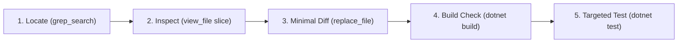

# 🧠 Rule 07 — AI Agent Token Efficiency & Precision Engineering Protocol

> **Target Layer**: All AI Agent Workflows & Developer Tooling in Antigravity (Gemini 2.5 / 3.x Flash & Pro)  
> **Key Objective**: Minimize token consumption (prompt + completion) while maximizing code accuracy, zero-hallucination execution, and strict adherence to Lexora's Clean Architecture.

---

## 1. Context & Token Economy (Tiết Kiệm Token & Tối Ưu Context Window)

### 1.1 Targeted Context Retrieval over Blind File Dumps
- **Targeted Slicing (`view_file`)**:
  - **NEVER** view entire files (>150 lines) when inspecting a specific method, property, or error location.
  - **ALWAYS** use `grep_search` first to find the exact line numbers of the symbol, then call `view_file` with a tight range (typically 30–60 lines, e.g. `StartLine = 120, EndLine = 170`).
  - **NEVER** call `view_file` without line boundaries unless the file is known to be tiny (<50 lines).
  - Do **NOT** re-read files or slices that were already retrieved and visible in the recent conversation context.
- **Optimized Ripgrep (`grep_search`)**:
  - Always use `Includes` to filter file types (e.g. `Includes: ["*.cs"]`, `Includes: ["*.xaml"]`) to avoid scanning binary or build folders.
  - Search for exact symbols or unique identifiers (`IsRegex = false`) to reduce noisy matches.

### 1.2 In-Place Surgical Patching over Full-File Rewrites
- **Zero Full-File Overwrites for Existing Code**:
  - **NEVER** call `write_to_file` with `Overwrite = true` on existing codebase files just to modify a few lines. This drains thousands of completion tokens, risks truncating imports or helper methods, and pollutes git history.
  - **ALWAYS** use `replace_file_content` for contiguous edits or `multi_replace_file_content` for non-contiguous changes.
- **Minimal Anchor Lines (Context Preservation)**:
  - Keep `TargetContent` strictly focused on the lines being changed, plus at most 1–2 surrounding anchor lines for uniqueness.
  - Never include 50 lines of unmodified code inside a replacement chunk just to change 2 lines.

### 1.3 Focused Terminal Execution & Output Paging (`run_command`)
- **Suppressing Verbose Output**:
  - Avoid flooding the context window with hundreds of lines of build or test logs.
  - **Quiet Builds**:
    ```powershell
    dotnet build Lexora.slnx -v q /clp:ErrorsOnly
    ```
    *(When successful, outputs 0 tokens. When failing, displays only the actionable errors).*
  - **Targeted Test Execution**:
    - During development or bug fixing, do **NOT** run the entire test suite on every minor change.
    - Run only the relevant test class or method:
      ```powershell
      dotnet test --filter "FullyQualifiedName~VocabularyServiceTests" --logger "console;verbosity=minimal"
      dotnet test --filter "FullyQualifiedName~Sm2SpacedRepetitionEngineTests" --logger "console;verbosity=minimal"
      ```
    - Only run the full test suite (`dotnet test Lexora.slnx --no-build`) during the final Quality Gate verification.
  - **Compact Git Operations**:
    - Use compact flags: `git status -s`, `git diff --stat`, or `git log -n 5 --oneline`. Never dump full multi-page git diffs into terminal context.

### 1.4 High-Density, Concise Communication
- **No Echoing**: Do **not** repeat, paraphrase, or summarize the user's prompt back to them.
- **Direct Technical Responses**:
  - State the architectural rationale, file changes with clickable markdown links (`[FileName](file:///...)`), and build/test verification results.
  - Do **not** dump entire unmodified file listings into chat responses; present only concise diffs or focused explanations of core logic.

---

## 2. Precision Engineering & Anti-Hallucination Invariants (Code Chính Xác Tuyệt Đối)

### 2.1 The Standard 5-Step Execution Cycle
To guarantee zero defects and avoid iterative churn, every agent action must follow:

1. **Locate**: Pinpoint existing classes, signatures, and contracts before writing code.
2. **Inspect**: Read the specific 30–60 line definition to verify parameter types and return contracts.
3. **Minimal Diff**: Apply atomic edits using minimal anchor lines.
4. **Build Check**: Compile with `-v q /clp:ErrorsOnly` to immediately catch syntax, type, or AOT issues.
5. **Targeted Test**: Validate domain logic with filtered tests.

### 2.2 Verify Before Declaring Abstractions
- **Avoid Contract Duplication**:
  - Before declaring a new Entity, DTO, Repository, Enum, Converter, or Service, verify if an equivalent or extensible contract already exists in `Lexora.Domain` or `Lexora.Application`.
  - Reuse domain entities (`Word`, `ExampleSentence`, `ContextUnit`, `GrammarRule`, `StudyLog`) and enums (`CefrLevel`, `ExamType`, `LearningStatus`, `PartOfSpeech`).
- **Strict Cascade of Changes**:
  - Implement strictly in dependency order: `Domain` $\rightarrow$ `Application` $\rightarrow$ `Infrastructure` $\rightarrow$ `Presentation`.
  - Never invert dependencies (e.g. Presentation dependencies inside Application or Domain).

### 2.3 C# 13 / .NET 10 Idiomatic Precision
- **Observable Properties**: Use C# 13 partial properties with CommunityToolkit MVVM:
  ```csharp
  [ObservableProperty]
  public partial string SearchTerm { get; set; } = string.Empty;
  ```
  *(Mandatory: Prevents CsWinRT / AOT warnings and ensures 100% WinUI 3 XAML markup compilation).*
- **Primary Constructors**: Use primary constructors for dependency injection across services and ViewModels:
  ```csharp
  public class VocabularyService(IVocabularyRepository repository, IUnitOfWork unitOfWork) : IVocabularyService
  ```
- **Async & Cancellation Tokens**:
  - All I/O-bound methods must be asynchronous, return `Task` or `Task<T>`, accept `CancellationToken cancellationToken = default`, and cleanly propagate it to EF Core and file streams.
- **Defensive Null Safety**:
  - Enforce `#nullable enable`.
  - Use modern guard clauses (`ArgumentNullException.ThrowIfNull(...)`, `ArgumentException.ThrowIfNullOrWhiteSpace(...)`) rather than blanket `!` suppression.

### 2.4 WinUI 3 & Fluent 2 Framework Specifics
- **Zero Hex Colors**:
  - **NEVER** use hardcoded `#RRGGBB` or `#AARRGGBB` in XAML or C#.
  - **ALWAYS** use Fluent theme resources: `{ThemeResource CardBackgroundFillColorDefaultBrush}`, `{ThemeResource TextFillColorPrimaryBrush}`, `{ThemeResource AccentTextFillColorPrimaryBrush}`, etc.
- **DataTemplate & Flyout Markup Scope**:
  - `{x:Bind}` inside a `DataTemplate` cannot access parent ViewModel properties via `ElementName` or page methods. Keep DataTemplates strictly scoped to item DTOs.
  - Complex elements inside `<Flyout>` or `<MenuFlyout>` must avoid complex `{x:Bind}` to page methods (which causes `Xaml Internal Error error WMC9999`); use code-behind event handlers or ViewModel command bindings in the main visual tree.
- **Thread Dispatching**:
  - Any UI updates triggered from background threads or async events must be dispatched via `DispatcherQueue.TryEnqueue(() => { ... })`.
- **Dialog Architecture & Safety**:
  - Always assign `dialog.XamlRoot = this.XamlRoot;`.
  - Position validation errors at the top of the dialog using an `InfoBar`.
  - Insert `await Task.Yield();` between sequential dialog invocations to prevent `InvalidOperationException` ("An async operation was already in progress").
- **Bilingual i18n Synchronization**:
  - Every newly added user-facing text label must be added to **both** `vi-VN` and `en-US` dictionaries in `LocalizationService.cs`.

### 2.5 Spaced Repetition (SM-2) Integrity
- Ease Factor floor must **never** drop below 1.3: $EF = \max(1.3, EF')$.
- Interval progression: $I_1 = 1$, $I_2 = 6$, $I_n = \lceil I_{n-1} \times EF \rceil$ for $q \ge 2$; lapse reset ($I = 1, \text{Repetitions} = 0$) for $q < 2$.
- Submissions must be atomic: create `StudyLog`, update `Word`, update streak, and commit via `_unitOfWork.SaveChangesAsync()`.
- Guard rating UI buttons with `IsSubmitting` flags against re-entrant double clicks.

---

## 3. Self-Correction & Error Recovery Protocol

When a compiler error or test failure occurs:
1. **Targeted Diagnosis**:
   - Read the exact file name, line number, and error code (e.g. `CS0103`, `CS8618`) from the build output.
   - Do **NOT** read the whole file. View only the $\pm 5$ lines surrounding the error line.
2. **Surgical Fix**:
   - Apply a precise `replace_file_content` targeting the specific variable, missing using directive, or typo.
   - Never regenerate or rewrite the whole class in panic.
3. **Re-verify Immediately**:
   - Run `dotnet build Lexora.slnx -v q /clp:ErrorsOnly` to confirm the error is cleared with 0 warnings and 0 errors.
