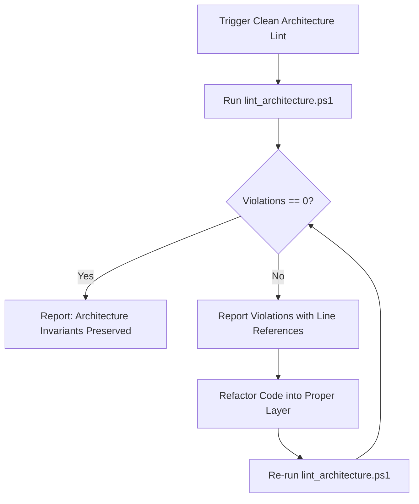

# 🏛️ Skill: Clean Architecture Boundary Lint

## 1. Capabilities & Scope
This skill provides automated static analysis across the entire Lexora solution to verify that layer boundaries remain strictly uncompromised according to the [Architecture Boundaries Specification](./references/architecture_boundaries.md).

### Invariants Enforced:
1. **Domain Purity (`Lexora.Domain`)**: Pure .NET 10. Contains entities, value objects, and domain exceptions. Absolutely zero references to EF Core, SQLite, Windows App SDK, or other solution projects.
2. **Application Boundary (`Lexora.Application`)**: References ONLY `Lexora.Domain`. Never references Infrastructure, Presentation, or EF Core.
3. **Presentation Boundary (`Lexora.Presentation`)**: Views and ViewModels must NEVER directly instantiate or call `LexoraDbContext` or `Microsoft.EntityFrameworkCore`. All data orchestration must pass through Application services or repository interfaces.

---

## 2. Execution Workflow



### Execution Commands:

#### Standard Verification:
```powershell
powershell -ExecutionPolicy Bypass -File .agents/skills/clean-architecture-lint/scripts/lint_architecture.ps1
```

#### JSON Output (for CI / Quality Gates):
```powershell
powershell -ExecutionPolicy Bypass -File .agents/skills/clean-architecture-lint/scripts/lint_architecture.ps1 -JsonOutput
```

---

## 3. Remediation Guide

### Direct DbContext in ViewModel (Violation)
```diff
- public partial class VocabularyViewModel : ObservableObject
- {
-     private readonly LexoraDbContext _context; // VIOLATION
-     public async Task LoadWords() => Words = await _context.Words.ToListAsync();
- }
+ public partial class VocabularyViewModel : ObservableObject
+ {
+     private readonly IVocabularyService _vocabService; // COMPLIANT
+     public async Task LoadWords() => Words = await _vocabService.GetWordsAsync();
+ }
```

---

## 4. Verification Check
- Output contains `Result: CLEAN ARCHITECTURE INVARIANTS 100% PRESERVED!`.
- Exit code is `0`.
