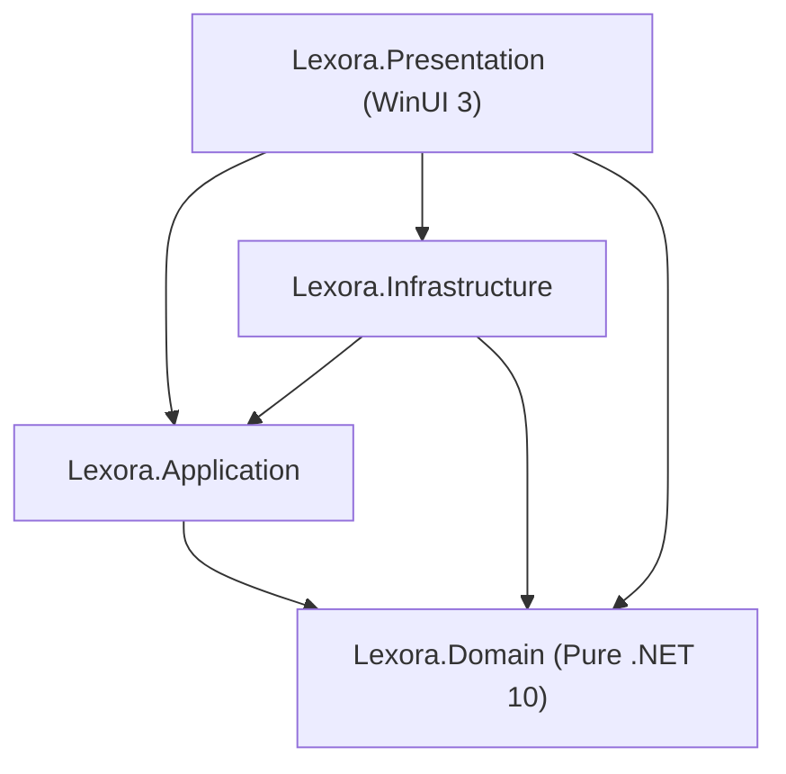

# 🏛️ Clean Architecture Boundaries & Invariants

## 1. Architectural Layers & Allowed Dependencies

## 2. Invariant Rules Table

| Layer | Allowed Project References | Forbidden Dependencies / Usings | Responsibilities |
| :--- | :--- | :--- | :--- |
| **`Lexora.Domain`** | *None* | EF Core, SQLite, Windows App SDK, Application, Presentation | Core entities, domain enums, value objects, domain exceptions. Pure .NET 10. |
| **`Lexora.Application`** | `Lexora.Domain` | EF Core, SQLite, Windows App SDK, Presentation | Use cases, DTOs, service interfaces (`IVocabularyService`), SM-2 business logic. |
| **`Lexora.Infrastructure`** | `Lexora.Application`, `Lexora.Domain` | Windows App SDK, Presentation | EF Core DbContext, SQLite repositories, audio synthesis & cache, database backup routines. |
| **`Lexora.Presentation`** | `Lexora.Application`, `Lexora.Infrastructure`, `Lexora.Domain` | **Direct `LexoraDbContext` usage**, `Microsoft.EntityFrameworkCore` in Views/ViewModels | WinUI 3 Views, ViewModels, Converters, Theme/Localization services. |

## 3. Absolute Prohibitions
1. **No EF Core in Views/ViewModels**: Never call `_dbContext.Words.Where(...)` in any presentation class. All database operations must go through Application services or repository interfaces.
2. **Atomic Commits**: Mutations spanning multiple entities must commit in a single unit of work (`await _unitOfWork.SaveChangesAsync(cancellationToken)`).
3. **No UI Elements in Application/Domain**: Never import `Microsoft.UI.Xaml` in Application or Domain layers.
