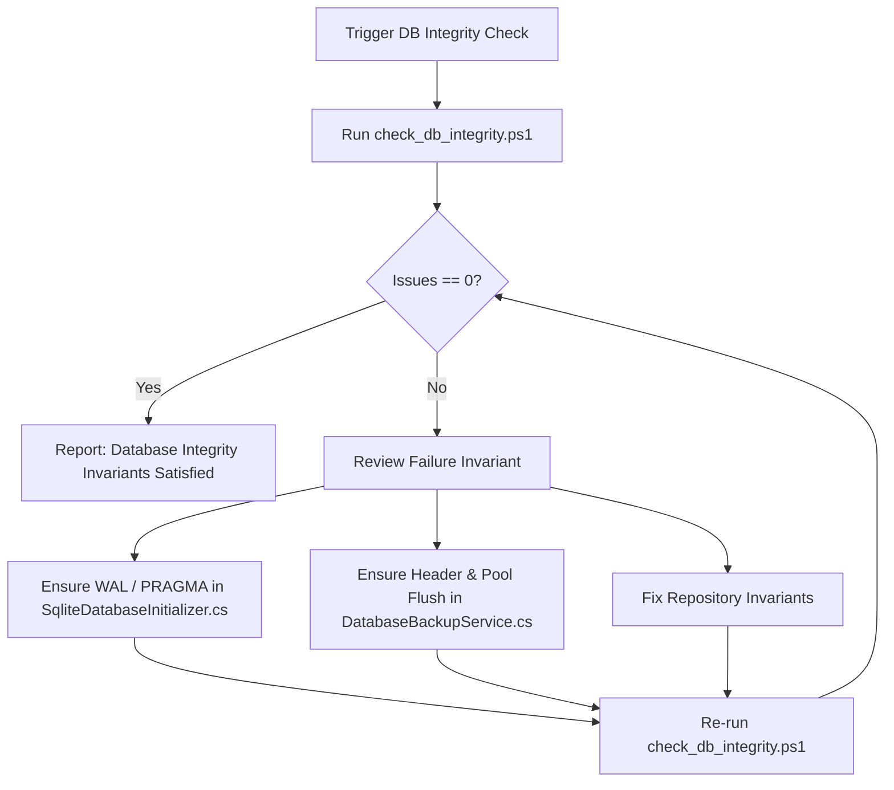

# 🗄️ Skill: Database Migration & Schema Integrity Check

## 1. Scope & Capabilities
This skill guarantees database resilience, schema consistency, and backup/restore safety across `Lexora.Infrastructure` and SQLite data storage.

### Core Invariants Enforced:
1. **WAL Mode & High-Performance PRAGMAs**: SQLite database must initialize with `PRAGMA journal_mode = WAL`, `PRAGMA synchronous = NORMAL`, and `PRAGMA foreign_keys = ON`.
2. **16-Byte Magic Header Verification**: Before restoring any backup file, verify that the first 16 bytes match `"SQLite format 3\0"` (`0x53, 0x51, 0x4C, 0x69, 0x74, 0x65, 0x20, 0x66, 0x6F, 0x72, 0x6D, 0x61, 0x74, 0x20, 0x33, 0x00`).
3. **Connection Pool Flushing**: Must execute `SqliteConnection.ClearAllPools()` and remove stale lockfiles (`lexora.db-wal`, `lexora.db-shm`) before replacing the active database file.
4. **Integration Test Integrity**: All SQLite integration tests must pass cleanly.

---

## 2. Step-by-Step Execution Workflow



### Execution Commands:

#### Standard Verification:
```powershell
powershell -ExecutionPolicy Bypass -File .agents/skills/db-migration-check/scripts/check_db_integrity.ps1
```

#### Fast Verification (Skip Integration Tests):
```powershell
powershell -ExecutionPolicy Bypass -File .agents/skills/db-migration-check/scripts/check_db_integrity.ps1 -SkipTests
```

#### JSON Output (for CI / Hooks):
```powershell
powershell -ExecutionPolicy Bypass -File .agents/skills/db-migration-check/scripts/check_db_integrity.ps1 -JsonOutput
```

---

## 3. Verification Check
- Exit code must be `0`.
- Output confirms `RESULT: DATABASE & MIGRATION INTEGRITY INVARIANTS 100% SATISFIED!`.
