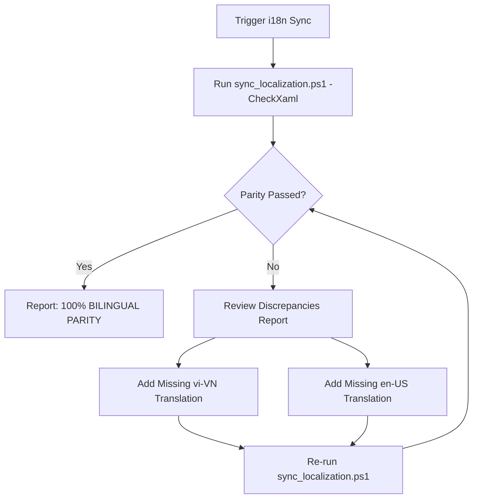

# 🌐 Skill: Multi-Language Localization Synchronization (i18n)

## 1. Capabilities & Purpose
This skill validates that all user-facing strings in the Lexora desktop application maintain 100% bilingual parity between Vietnamese (`vi-VN`) and English (`en-US`). It ensures that whenever a new feature, dialog, or view model is introduced, no key is left un-translated or orphaned.

### Key Invariants Enforced:
1. **100% Dictionary Parity**: Every key present in `_resources["vi-VN"]` must have an exact matching entry in `_resources["en-US"]`, and vice versa.
2. **Standard Key Nomenclature**: Keys must follow `Category_Descriptor` (e.g. `Vocab_AddWord`, `Review_RatingGood`). See [Localization Guidelines](./references/localization_guidelines.md).
3. **XAML Reference Integrity**: Every key used via `{x:Bind Loc['Key']}` or `Loc.GetString('Key')` must exist in `LocalizationService.cs`.

---

## 2. Step-by-Step Execution Workflow



### Execution Commands:

#### Full Synchronization & XAML Reference Audit:
```powershell
powershell -ExecutionPolicy Bypass -File .agents/skills/i18n-localization-sync/scripts/sync_localization.ps1 -CheckXaml
```

#### JSON Output (for CI / Hooks):
```powershell
powershell -ExecutionPolicy Bypass -File .agents/skills/i18n-localization-sync/scripts/sync_localization.ps1 -JsonOutput
```

---

## 3. Adding New Localization Keys Protocol
When adding a new key (e.g. `Vocab_ExportCsv`):
1. Locate `src/Lexora.Presentation/Services/LocalizationService.cs`.
2. Insert the Vietnamese key into the `["vi-VN"]` section under the corresponding category:
   ```csharp
   ["Vocab_ExportCsv"] = "Xuất danh sách (CSV)",
   ```
3. Insert the exact matching English key into the `["en-US"]` section:
   ```csharp
   ["Vocab_ExportCsv"] = "Export Vocabulary (CSV)",
   ```
4. Run the sync tool to verify 0 discrepancies:
   ```powershell
   powershell -ExecutionPolicy Bypass -File .agents/skills/i18n-localization-sync/scripts/sync_localization.ps1
   ```

---

## 4. Verification Check
- Output contains `Result: PERFECT LOCALIZATION PARITY (100% synchronized)!`.
- Exit code must be `0`.
