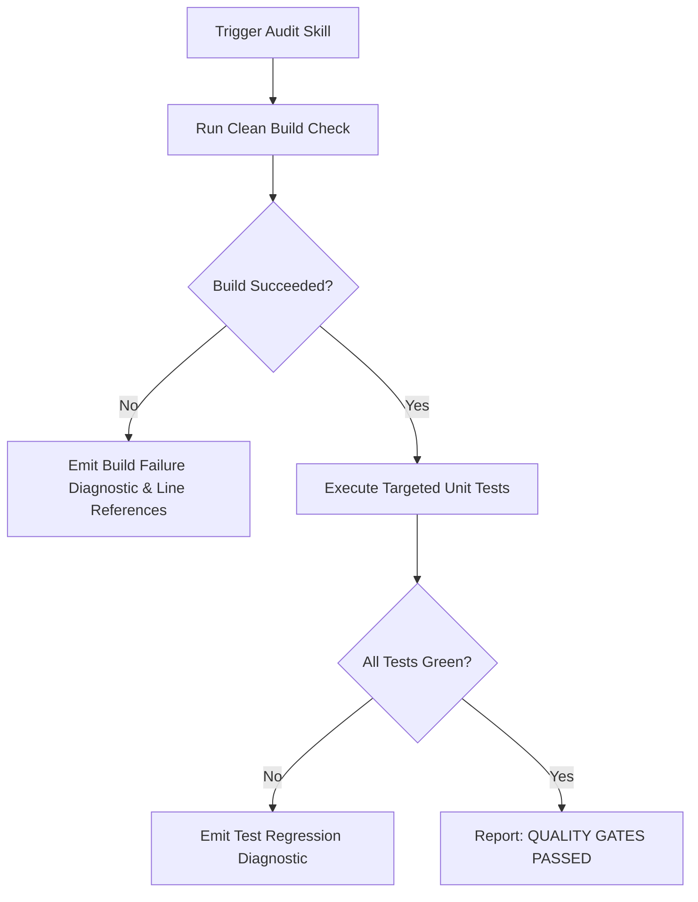

# 🔍 Skill: Lexora Quality Audit

## 1. Capabilities & Pre-requisites
- **Target Solution**: `Lexora.slnx` (.NET 10 solution).
- **Execution Environment**: Windows PowerShell 5.1+ or PowerShell 7+ on Windows.
- **Constraints**: Must be executed from the repository root directory (`d:\LEARN\Lexora`).
- **Invariants Enforced**:
  - `0 Warning(s)`, `0 Error(s)`.
  - All automated tests must remain green (zero regression).

---

## 2. Step-by-Step Execution Workflow



### Step 1: Silent Build Verification
Execute the quiet compilation command:
```powershell
powershell -ExecutionPolicy Bypass -File .agents/skills/lexora-quality-audit/scripts/audit_quality_gates.ps1 -Mode "BuildOnly"
```

### Step 2: Full Test Suite Verification (Optional / Full Audit)
```powershell
powershell -ExecutionPolicy Bypass -File .agents/skills/lexora-quality-audit/scripts/audit_quality_gates.ps1 -Mode "Full"
```

---

## 3. Error Handling & Recovery Protocols

| Error Condition | Root Cause | Recovery Protocol |
| :--- | :--- | :--- |
| `ERR_PROCESS_LOCKED` | `intermediatexaml\Lexora.Presentation.dll` is locked by another process | Check and terminate lingering `Microsoft.UI.Xaml.Markup.Compiler` or `Lexora.exe` processes. |
| `ERR_COMPILATION_FAIL` | Syntax error or namespace mismatch | Inspect $\pm 5$ lines surrounding the failure line; do not rewrite the entire file. |
| `ERR_TEST_REGRESSION` | One or more unit/integration tests failed | Inspect test failure output; fix the underlying business logic in Domain/Application. |

---

## 4. Verification Check
- Output JSON must contain `"status": "PASSED"`.
- Exit code must be `0`.
