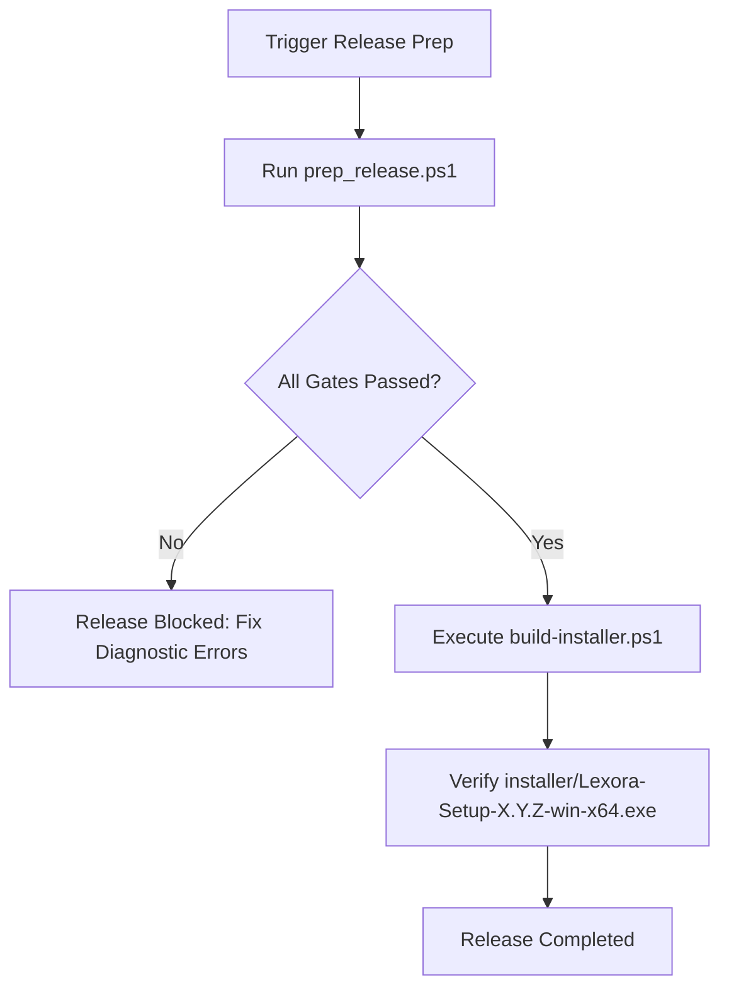

# 🚀 Skill: Release Package Preparation & Verification

## 1. Capabilities & Workflow
This skill orchestrates the end-to-end release readiness pipeline for the Lexora Windows desktop application. It consolidates verification across compilation, test suites, architecture boundaries, localization parity, SM-2 engine integrity, and packaging scripts.

### Steps in Release Workflow:
1. **Pre-flight Quality Gate**: Verifies 0 build warnings, 0 build errors, and all tests passing.
2. **Architecture & Design Audit**: Runs boundary lint and Fluent 2 checks.
3. **Localization Parity**: Ensures 100% key synchronization between `vi-VN` and `en-US`.
4. **Changelog Consolidation**: Checks fragments in `changelog/unreleased/` against [Keep a Changelog](https://keepachangelog.com/).
5. **Installer Generation**: Packages self-contained WinUI 3 binaries via Inno Setup 6 with SHA256 checksums.

---

## 2. Step-by-Step Execution Workflow



### Execution Commands:

#### Fast Readiness Verification:
```powershell
powershell -ExecutionPolicy Bypass -File .agents/skills/release-package-prep/scripts/prep_release.ps1 -TargetVersion "1.0.0"
```

#### Build Installer Package:
```powershell
powershell -ExecutionPolicy Bypass -File ./build-installer.ps1 -Version "1.0.0"
```

---

## 3. Checklist
Consult the [Release Checklist](./references/release_checklist.md) for full operational signing, changelog merging, and release notes protocols.
