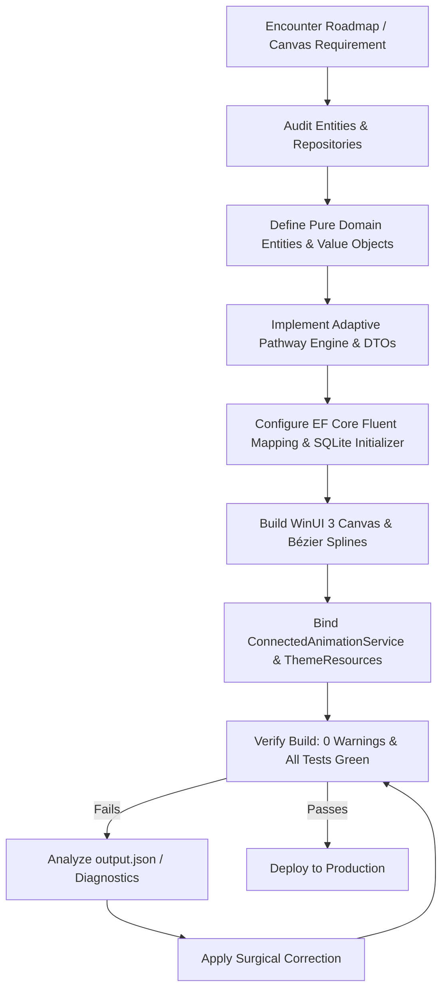

# 🗺️ Skill: WinUI 3 Interactive Roadmap & Dynamic Pathway Builder

## 1. Capabilities & Purpose
This skill encapsulates and automates the creation, visual rendering, and performance tuning of interactive learning roadmaps, adaptive skill tree graphs, and serpentine Bézier splines in **WinUI 3 / Windows App SDK** desktop applications following **Clean Architecture** patterns.

### Key Technical Invariants Enforced:
1. **Zero Hardcoded Colors**: 100% adherence to `{ThemeResource ...}` context brushes (`LayerFillColorDefaultBrush`, `CardBackgroundFillColorDefaultBrush`, `AccentFillColorDefaultBrush`, `SystemFillColorSuccessBrush`).
2. **Smooth Bézier Curve Mathematics**: Connects consecutive nodes with cubic Bézier segments (`Point1`, `Point2`, `Point3`) using midpoint vertical tangents (`(x0, midY)` and `(x1, midY)`) to prevent sharp corners and layout stutter.
3. **ConnectedAnimation Lifecycle**: Smoothly animates user selection transitions between roadmap node markers and the detail inspector (`ConnectedAnimationService.GetForCurrentView().PrepareToAnimate("nodeTransition", rootElement)`).
4. **Anti-WMC9999 XAML Compiler Safety**:
   - Never use string indexers in `{x:Bind}` (e.g. `Loc['Key']` causes `WMC9999`); always use method invocations `{x:Bind Loc.GetString('Key')}`.
   - Never use `ConverterParameter` without an explicit `Converter={...}`.
   - Never apply `TargetNullValue` to non-nullable value types (`double`, `int`).
5. **Clean Architecture Cascade**: Domain POCO entities (`StudyRoadmap`, `RoadmapMilestone`, `RoadmapNode`) $\rightarrow$ Application DTOs/Engine (`RoadmapEngine`, `RoadmapService`) $\rightarrow$ Infrastructure Repositories (`RoadmapRepository`) $\rightarrow$ Presentation View/ViewModel (`RoadmapPage`, `RoadmapViewModel`).

---

## 2. Execution Workflow



---

## 3. Automation Scripts & Verifications

Run the automated roadmap visual and data integrity verification script:

```powershell
powershell -ExecutionPolicy Bypass -File .agents/skills/roadmap-visual-builder/scripts/verify_roadmap_visuals.ps1
```

---

## 4. Golden Code Patterns

### 4.1 Cubic Bézier Spline Segment Generator:
```csharp
var p0 = new Point(nodeA.CanvasX + halfWidth, nodeA.CanvasY + halfHeight);
var p1 = new Point(nodeB.CanvasX + halfWidth, nodeB.CanvasY + halfHeight);

double midY = (p0.Y + p1.Y) / 2.0;
var cp1 = new Point(p0.X, midY);
var cp2 = new Point(p1.X, midY);

var bezier = new BezierSegment
{
    Point1 = cp1,
    Point2 = cp2,
    Point3 = p1
};
trackFigure.Segments.Add(bezier);
```

### 4.2 Fluent 2 Connected Animation Invocation:
```csharp
// Source View (Node Click)
var anim = ConnectedAnimationService.GetForCurrentView();
anim.PrepareToAnimate("nodeTransition", nodeBorder);
ViewModel.SelectNode(clickedNode);

// Destination View (Inspector Loaded)
var anim = ConnectedAnimationService.GetForCurrentView().GetAnimation("nodeTransition");
if (anim != null)
{
    anim.TryStart(InspectorTitle);
}
```

