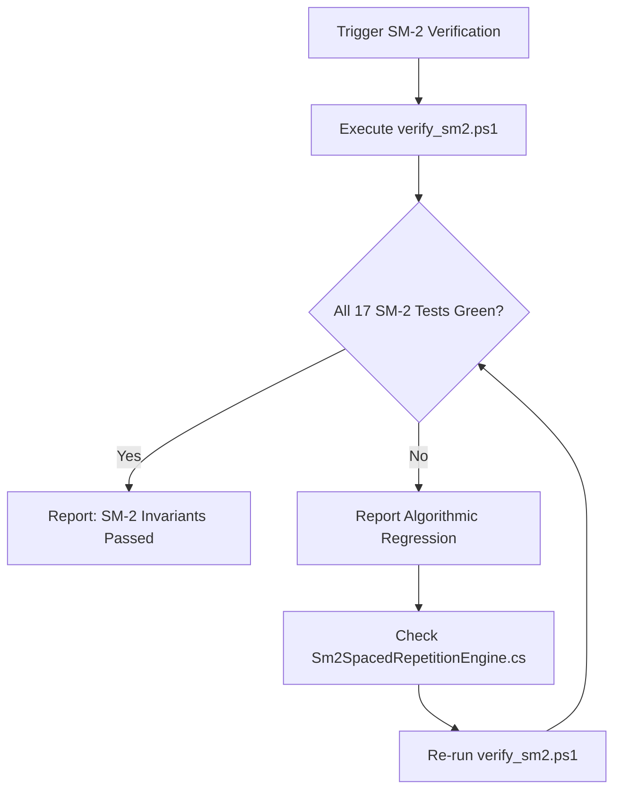

# 🧠 Skill: SM-2 Spaced Repetition Engine Verification

## 1. Capabilities & Scope
This skill verifies that any modifications to `Sm2SpacedRepetitionEngine`, `IReviewService`, `ReviewViewModel`, or review submission pipelines strictly preserve the mathematical invariants of the SuperMemo-2 (SM-2) algorithm.

### Key Invariants Enforced:
1. **Ease Factor Floor**: $EF \ge 1.3$ must be preserved across all rating sequences.
2. **Quality Ratings (0 to 4)**:
   - Rating `0` / `1` (Again): Resets repetition count to 0, sets next interval to 1 day.
   - Rating `2` (Hard): Increments repetition count, decreases ease factor, advances interval.
   - Rating `3` (Good): Increments repetition count, preserves or slightly adjusts ease factor.
   - Rating `4` (Easy): Increments repetition count, increases ease factor, optimizes interval.
3. **Atomic Study Logs**: Each review submission logs a timestamped `StudyLog` entry and updates user streak.

---

## 2. Execution Workflow



### Execution Commands:

#### Fast Verification:
```powershell
powershell -ExecutionPolicy Bypass -File .agents/skills/sm2-algorithm-verify/scripts/verify_sm2.ps1
```

#### JSON Output (for CI / Quality Gates):
```powershell
powershell -ExecutionPolicy Bypass -File .agents/skills/sm2-algorithm-verify/scripts/verify_sm2.ps1 -JsonOutput
```

---

## 3. Reference Material
Consult [SM-2 Specification](./references/sm2_specification.md) for full mathematical formulas and edge cases.
