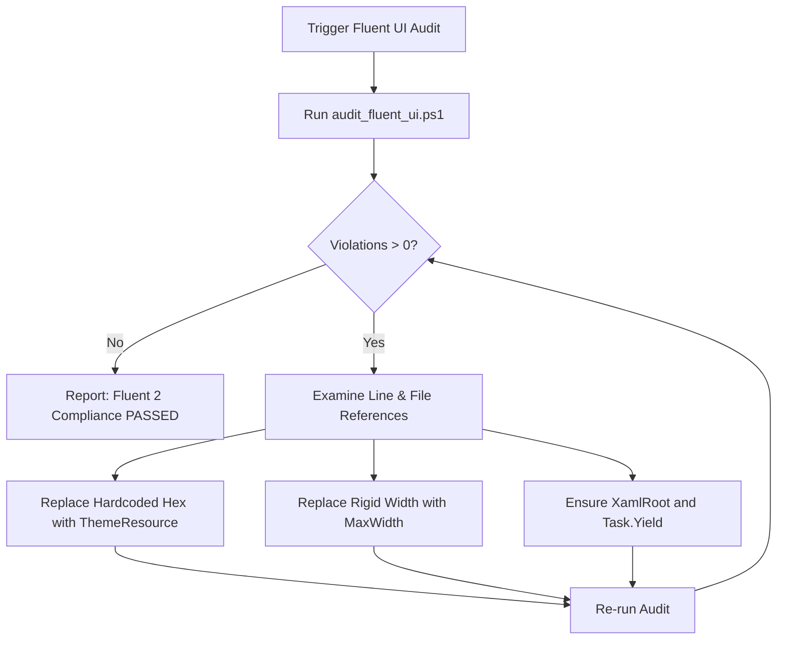

# 🎨 Skill: WinUI 3 & Fluent 2 UI/UX Audit

## 1. Capabilities & Purpose
This skill inspects WinUI 3 views, user controls, data templates, and code-behind files in `src/Lexora.Presentation/` to ensure 100% adherence to Microsoft Fluent 2 design standards and Lexora's zero-hardcoded-color and anti-clutter rules.

### Key Invariants Enforced:
1. **Zero Hardcoded Colors**: UI controls must never specify literal hex colors (`#FFFFFF`, `#123456`). Always use `{ThemeResource ...}` brushes.
2. **Responsive Layouts**: No rigid fixed widths (`Width="680"`, etc.) that cause viewport clipping on 1366x768 or window resizing. Use `MaxWidth` with `HorizontalAlignment="Stretch"`.
3. **Modal & Dialog Safety**: Every `ContentDialog` must assign `XamlRoot` and precede sequential modal transitions with `await Task.Yield()`.
4. **Theme Brush Reference**: Consult the [Fluent Brushes Cheatsheet](./references/fluent_brushes_cheatsheet.md) for approved resource keys.

---

## 2. Execution Workflow



### Execution Commands:

#### Scan Entire Presentation Layer:
```powershell
powershell -ExecutionPolicy Bypass -File .agents/skills/winui3-fluent-audit/scripts/audit_fluent_ui.ps1
```

#### Scan Single File:
```powershell
powershell -ExecutionPolicy Bypass -File .agents/skills/winui3-fluent-audit/scripts/audit_fluent_ui.ps1 -TargetFile "src/Lexora.Presentation/Views/VocabularyPage.xaml"
```

#### JSON Output (for CI / Quality Gates):
```powershell
powershell -ExecutionPolicy Bypass -File .agents/skills/winui3-fluent-audit/scripts/audit_fluent_ui.ps1 -JsonOutput
```

---

## 3. Remediation Examples

### 3.1 Hardcoded Color Replacement
```diff
- <Border Background="#FFFFFF" BorderBrush="#E5E5E5" BorderThickness="1">
-     <TextBlock Text="{x:Bind Word.Term}" Foreground="#000000" />
+ <Border Background="{ThemeResource CardBackgroundFillColorDefaultBrush}"
+         BorderBrush="{ThemeResource CardStrokeColorDefaultBrush}"
+         BorderThickness="1">
+     <TextBlock Text="{x:Bind Word.Term}" Foreground="{ThemeResource TextFillColorPrimaryBrush}" />
```

### 3.2 Responsive Width Adaptation
```diff
- <Grid Width="720" HorizontalAlignment="Center">
+ <Grid MaxWidth="720" HorizontalAlignment="Stretch">
```

### 3.3 Safe Dialog Instantiation
```diff
  var dialog = new WordEditDialog(viewModel)
  {
+     XamlRoot = this.XamlRoot
  };
+ await Task.Yield();
  await dialog.ShowAsync();
```

---

## 4. Verification & Exit Criteria
- Audit command returns exit code `0`.
- Output summary confirms `ZERO VIOLATIONS`.
