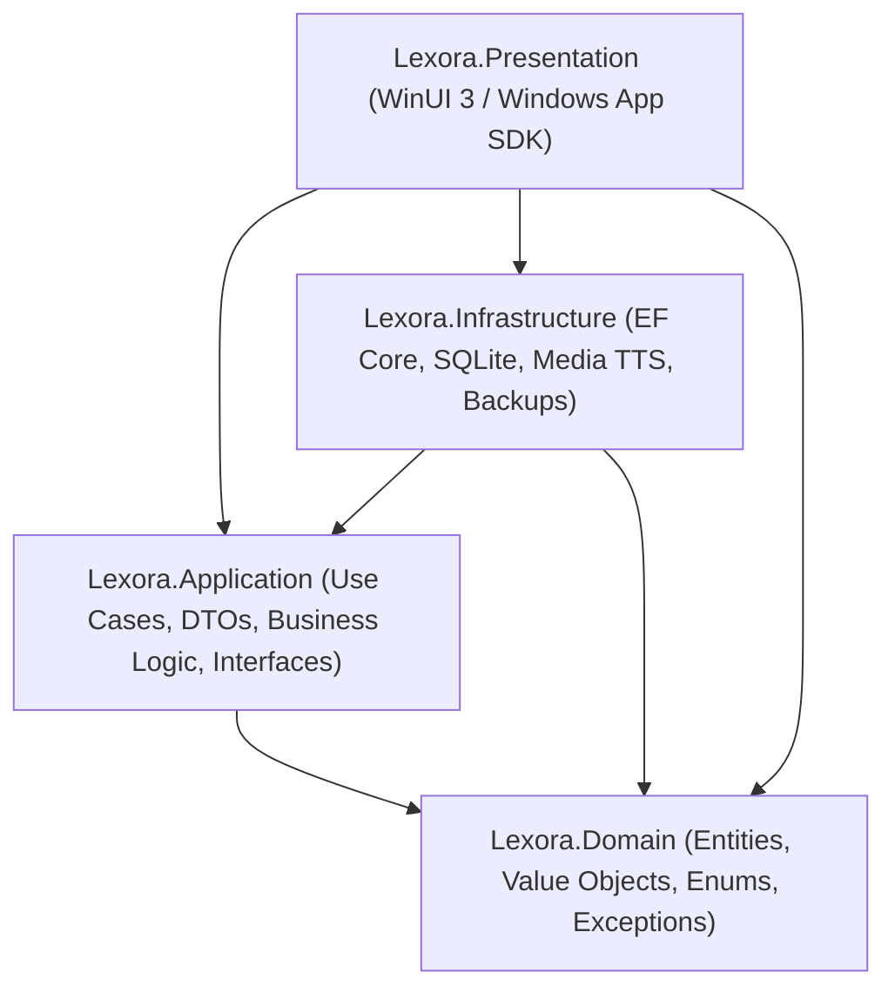

# 🏛️ AGENTS.md — Developer & AI Agent Guidelines for Lexora

> **Lexora** is a high-performance, offline-first English learning and vocabulary management desktop application designed for TOEIC, IELTS, and VSTEP exam preparation. Built with **.NET 10**, **WinUI 3 / Windows App SDK**, and **Entity Framework Core 10 (SQLite)** following strict **Clean Architecture** patterns.

Any developer or AI agent contributing to this repository **MUST** strictly adhere to the architectural, design, code quality, and verification invariants outlined below.

---

## 1. Architectural Integrity & Boundary Rules

### 1.1 Dependency Hierarchy & Separation of Concerns
Lexora follows a strict **Clean Architecture** layout:



- **`Lexora.Domain`**: Pure .NET library. **CANNOT** reference any other project, ORM (EF Core), or UI framework. Contains core entities (`Word`, `ExampleSentence`, `ContextUnit`, `GrammarRule`, `StudyLog`), domain enums (`CefrLevel`, `ExamType`, `LearningStatus`), value objects, and domain exceptions.
- **`Lexora.Application`**: Contains application logic, service interfaces, DTOs, and mappings. References **ONLY** `Lexora.Domain`.
- **`Lexora.Infrastructure`**: Implements repositories, EF Core DbContext, SQLite configurations, TTS audio playback, file storage, and database backup routines. References `Lexora.Application` and `Lexora.Domain`.
- **`Lexora.Presentation`**: WinUI 3 desktop client containing Views, ViewModels, Converters, Custom Controls, and Presentation-specific services. References `Lexora.Application`, `Lexora.Infrastructure`, and `Lexora.Domain`.

### 1.2 The Absolute Presentation Layer Boundary Rule
> [!CAUTION]
> **No EF Core in Views or ViewModels**: The Presentation layer **MUST NEVER** reference `LexoraDbContext`, execute direct LINQ-to-Entities queries, or manage raw EF transactions. All data retrieval, mutations, and business rules **MUST** be orchestrated through Application services or repository contracts (`IVocabularyService`, `IGrammarService`, `IReviewService`, `ITestService`, `IDatabaseBackupService`).

### 1.3 Database Transactions & Schema Evolution
- **Default Database Location**: `%LocalAppData%/Lexora/data/lexora.db` (with WAL mode enabled).
- **Entity Configurations**: Fluent configurations reside exclusively in `LexoraDbContext.OnModelCreating`. Do **NOT** scatter table or column attributes across Domain entities.
- **Single-Commit Atomic Operations**: Multi-entity mutations must be executed in a single atomic transaction (`await _unitOfWork.SaveChangesAsync(cancellationToken)`). Never perform intermediate commits that risk leaving the database in an inconsistent state.

---

## 2. Coding Standards & C# 13 / .NET 10 Conventions

- **Target Framework**:
  - Class Libraries (`Domain`, `Application`, `Infrastructure`, `Tests`): `net10.0`
  - Presentation Client (`Lexora.Presentation`): `net10.0-windows10.0.26100.0`
- **Modern C# 13/14 Syntax**:
  - **File-Scoped Namespaces**: All C# files must use file-scoped namespaces (e.g. `namespace Lexora.Application.Services;`).
  - **Primary Constructors**: Use primary constructors for dependency injection in classes and ViewModels where applicable.
  - **Nullable Reference Types**: Enable `#nullable enable` across all projects. Do not suppress nullability warnings with blanket `!` operators; use defensive validation or explicit guard clauses (`ArgumentNullException.ThrowIfNull(...)`).
  - **Asynchronous Operations**: All I/O-bound and database methods must be asynchronous, return `Task` or `Task<T>`, accept an optional `CancellationToken cancellationToken = default`, and handle task cancellations cleanly.

### 2.1 MVVM Architecture & CommunityToolkit Conventions
- ViewModels must inherit from `CommunityToolkit.Mvvm.ComponentModel.ObservableObject`.
- Use **C# 13 partial properties** with `[ObservableProperty]` to ensure 100% WinRT / CsWinRT AOT compatibility and prevent compiler warnings:
  ```csharp
  [ObservableProperty]
  public partial string SearchQuery { get; set; } = string.Empty;
  ```
- Use `[RelayCommand]` on ViewModel methods for clean command bindings.
- ViewModels must be registered in the Microsoft Dependency Injection container with appropriate lifetimes (usually `Transient` for transient pages or `Singleton` for shared app state).

---

## 3. WinUI 3 & Fluent 2 UI/UX Guidelines

### 3.1 Zero Hardcoded Colors Invariant
> [!IMPORTANT]
> **NEVER** use hardcoded hex color strings (e.g. `#FFF4CE`, `#E6F2FB`, `#323130`, `#FFFFFF`, `#000000`) for text, backgrounds, borders, or accents in XAML or code-behind. **ALWAYS** use Fluent `{ThemeResource ...}` brushes to ensure visual fidelity across Windows Light, Dark, and High-Contrast modes.

| Visual Intent | Forbidden Hardcoded Example | Mandatory Fluent Resource Brush |
| :--- | :--- | :--- |
| Window / Page Background | `#F3F3F3` / `#202020` | `{ThemeResource LayerFillColorDefaultBrush}` |
| Primary Card Surface | `#FFFFFF` / `#2C2C2C` | `{ThemeResource CardBackgroundFillColorDefaultBrush}` |
| Secondary / Subtle Surface | `#F9F9F9` / `#1F1F1F` | `{ThemeResource SubtleFillColorSecondaryBrush}` |
| Card Border / Outline | `#E5E5E5` / `#383838` | `{ThemeResource CardStrokeColorDefaultBrush}` |
| Primary Text | `#000000` / `#FFFFFF` | `{ThemeResource TextFillColorPrimaryBrush}` |
| Secondary / Subtitle Text | `#666666` / `#A0A0A0` | `{ThemeResource TextFillColorSecondaryBrush}` |
| Tertiary / Hint Text | `#8A8A8A` / `#6E6E6E` | `{ThemeResource TextFillColorTertiaryBrush}` |
| Accent Colored Text | `#0078D4` / `#60CDFF` | `{ThemeResource AccentTextFillColorPrimaryBrush}` |
| Critical / Danger State | `#FDE7E9` / `#C50F1F` | `{ThemeResource SystemFillColorCriticalBrush}` |
| Warning / Caution State | `#FFF4CE` / `#7A5B00` | `{ThemeResource SystemFillColorCautionBrush}` |
| Success / Mastered State | `#DFF6DD` / `#107C41` | `{ThemeResource SystemFillColorSuccessBrush}` |

### 3.2 Responsive Layouts & Anti-Clutter Design
- **Responsive Width Budgeting**: Never define rigid fixed widths (e.g. `Width="680"`) on cards, dialogs, or panels that could overflow on 1366x768 or non-maximized screens. Use `MaxWidth` with `HorizontalAlignment="Stretch"`.
- **Master-Detail Layouts**: Use flexible grid column proportions (e.g. `ColumnDefinitions="320,*"` or `ColumnDefinitions="360,*"`) and wrap all text elements (`TextWrapping="Wrap"`) in detail panes to prevent layout clipping and button collisions.
- **Adaptive Grids**: For collections and cards, use `ItemsRepeater` with a `UniformGridLayout` instead of horizontally scrolling fixed-width lists.
- **Scroll Isolation**: Always wrap tall pages in a `ScrollViewer` with `VerticalScrollBarVisibility="Auto"` and `HorizontalScrollBarVisibility="Disabled"` unless horizontal panning is explicitly required.

### 3.3 WinUI 3 Dialog Architecture & Safe Chaining
- Always set `dialog.XamlRoot = this.XamlRoot;` before displaying any `ContentDialog`.
- Position validation feedback at the **very top** of the dialog using an `InfoBar` so error messages are visible without scrolling.
- **Sequential Dialog Chaining Invariant**: WinUI 3 throws an `InvalidOperationException` (*"An async operation was already in progress"*) if a dialog is shown while another dialog is in the middle of closing. Always insert `await Task.Yield();` before opening the next dialog:
  ```csharp
  await firstDialog.ShowAsync();
  await Task.Yield(); // Allows the visual tree to clean up the closed dialog
  await secondDialog.ShowAsync();
  ```

### 3.4 WinUI 3 Markup Compilation & Scoping Nuances
- **DataTemplate Scope**: WinUI 3 `{x:Bind}` within a `DataTemplate` cannot bind to elements outside the item's `DataType` via `ElementName` or page properties. Keep templates bound directly to item DTO properties.
- **Flyout Scope**: Elements inside a `<Flyout>` or `<MenuFlyout>` cannot bind to page properties without triggering markup compiler exceptions (`Xaml Internal Error error WMC9999`). Use code-behind event handlers or placement in the main visual tree for complex bound controls.
- **Assembly Qualification**: When accessing application resources or singletons in code-behind, use `App.Current` rather than unqualified `Application.Current` to avoid ambiguity with `Lexora.Application`.

---

## 4. Real-Time Multi-Language Localization (i18n)

### 4.1 Architecture of `ILocalizationService`
Lexora includes an offline, dual-dictionary localization system supporting **Tiếng Việt (`vi-VN`)** and **English (`en-US`)**:
- Service interface: `ILocalizationService`
- Implementation: `LocalizationService` registered as a `Singleton` in DI.
- Key naming convention: `Category_Descriptor` (e.g. `Nav_Dashboard`, `Vocab_AddWord`, `Review_RatingGood`, `Settings_Theme`).

### 4.2 Dynamic Real-Time Switching Without App Restart
When the user toggles the application language in `SettingsPage`:
1. `ILocalizationService.SetLanguage(langCode)` updates `CultureInfo.CurrentCulture` and `CultureInfo.CurrentUICulture`, then raises the `LanguageChanged` event.
2. `MainWindow.xaml.cs` handles `LanguageChanged` to update the native window title and custom Fluent titlebar.
3. `ShellPage.xaml.cs` handles `LanguageChanged` to update all `NavigationViewItem` labels, global search placeholders, and re-navigates `ContentFrame` to reload the active page in the new language seamlessly.
4. Active views bind text labels using `{x:Bind Loc.GetString('KeyName')}` or `{x:Bind Loc['KeyName']}`.

---

## 5. Spaced Repetition (SM-2) Integrity

### 5.1 The SM-2 Mathematical Specification
All spaced repetition calculations must be routed through `ISpacedRepetitionEngine` (`Sm2SpacedRepetitionEngine`):
- **Rating Scale**:
  - `0` or `1`: Again (Complete blackout or incorrect recall)
  - `2`: Hard (Correct response with significant hesitation)
  - `3`: Good (Correct response with standard recall effort)
  - `4`: Easy (Perfect, instantaneous recall)
- **Ease Factor (EF) Floor**:
  $$EF' = EF + (0.1 - (4 - q) \times (0.08 + (4 - q) \times 0.02))$$
  The Ease Factor must **never** drop below 1.3 ($EF \ge 1.3$).
- **Interval Progression ($I$)**:
  - For $q < 2$ (Again / Lapse): $I = 1$ day, Repetitions = 0.
  - For $q \ge 2$:
    - Repetition 1: $I = 1$ day
    - Repetition 2: $I = 6$ days
    - Repetition $n > 2$: $I_n = \lceil I_{n-1} \times EF \rceil$ days.

### 5.2 Review Transactions & Concurrency Safety
- Every review submission must atomically create a `StudyLog` entry, update the `Word` entity's interval, ease factor, and due date, and call `IReviewRepository.UpdateStreakAsync`.
- Review card rating buttons in the UI must be guarded against rapid double-clicks (e.g. using `IsSubmitting` concurrency flags) to prevent re-entrant rating submissions.

---

## 6. Security, IO & Data Protection Invariants

### 6.1 Path Traversal Defense
> [!WARNING]
> Any service handling file exports, database backups, or cached audio files **MUST** sanitize filenames using an alphanumeric whitelist and verify canonical paths:
> ```csharp
> var fullPath = Path.GetFullPath(targetPath);
> if (!fullPath.StartsWith(allowedBaseDirectory, StringComparison.OrdinalIgnoreCase))
> {
>     throw new SecurityException("Potential path traversal attempt detected.");
> }
> ```

### 6.2 SQLite Backup & Restoration Integrity
1. **Magic Header Verification**: Before restoring any `.db` file, verify that the first 16 bytes match the SQLite header string:
   `"SQLite format 3\0"` (`0x53, 0x51, 0x4C, 0x69, 0x74, 0x65, 0x20, 0x66, 0x6F, 0x72, 0x6D, 0x61, 0x74, 0x20, 0x33, 0x00`).
2. **Connection Pool Flushing**: Prior to replacing the active database file, execute `SqliteConnection.ClearAllPools()` and delete any active write-ahead lockfiles (`lexora.db-wal`, `lexora.db-shm`).

### 6.3 Import Payload Limits & De-duplication
- All CSV and JSON import parsers must enforce a 20MB ceiling on input files.
- Incoming records must be normalized (trimmed, lowercased terms) and de-duplicated against existing database records prior to batch insertion.

---

## 7. Audio & Media Integration (TTS & Human Voice)

- **Two-Tier Audio Architecture**:
  1. **Tier 1 (Cached Human Audio)**: High-fidelity native audio files stored locally in `%LocalAppData%/Lexora/audio/cache/`, indexed by term hash (`SHA256`).
  2. **Tier 2 (Windows Speech Synthesis Fallback)**: Built-in `Windows.Media.SpeechSynthesis.SpeechSynthesizer` with UK (`en-GB`) and US (`en-US`) voice selection.
- **Playback Control**: Support configurable playback speeds (`0.75x`, `1.0x`, `1.25x`, `1.5x`) and ensure any ongoing audio playback is safely stopped before initiating a new playback stream.

---

## 8. Build, Quality Gates & Verification Protocol

Before completing any task, committing code, or declaring an issue resolved, developers and AI agents **MUST** execute and pass the following quality gates in PowerShell:

```powershell
# 1. Build the entire solution (Must finish with 0 warnings and 0 errors)
dotnet build Lexora.slnx

# 2. Run all unit and integration test suites (All 304 tests MUST pass)
dotnet test Lexora.slnx --no-build

# 3. Packaging & Installer Verification (When modifying deployment scripts)
powershell -ExecutionPolicy Bypass -File ./build-installer.ps1 -Version "1.0.0"
```

### Current Quality Gate Benchmark
- **Build Status**: `0 Warning(s)`, `0 Error(s)`.
- **Test Suite**: **304 / 304 Tests Passing** (255 Unit Tests + 49 Integration Tests, 0 Failed, 0 Skipped).

---

## 9. Repository Layout & File Navigation Map

```
Lexora/
├── Lexora.slnx                               # Solution file (.NET 10 slnx format)
├── AGENTS.md                                 # Developer & AI Agent master guidelines
├── PROGRESS.md                               # Project progress tracking and milestones
├── README.md                                 # User-facing overview & feature breakdown
├── build-installer.ps1                       # Inno Setup installer packaging script
├── build-release.ps1                         # Production release build script
├── rules/                                    # Detailed modular developer rules
│   ├── 01-clean-architecture.md              # Clean Architecture boundaries & DI patterns
│   ├── 02-csharp-dotnet-standards.md         # C# 13, .NET 10, MVVM and async standards
│   ├── 03-winui3-fluent-design.md            # Fluent 2 UI/UX, brushes, and layouts
│   ├── 04-security-and-data-protection.md    # Path traversal, backups, and file safety
│   ├── 05-spaced-repetition-sm2.md           # SM-2 formula, intervals, and streak engine
│   ├── 06-testing-and-verification.md        # Test suite requirements & CI verification
│   └── 07-agent-token-efficiency-and-accuracy.md # AI Agent token economy, precision coding & tooling protocol
├── src/
│   ├── Lexora.Domain/                        # Pure domain layer (Entities, Enums, Exceptions)
│   │   ├── Entities/                         # Word, ContextUnit, GrammarRule, StudyLog
│   │   ├── Enums/                            # CefrLevel, ExamType, LearningStatus, PartOfSpeech
│   │   └── Exceptions/                       # Domain-specific validation exceptions
│   ├── Lexora.Application/                   # Application layer (Services, DTOs, Interfaces)
│   │   ├── DTOs/                             # WordDto, GrammarRuleDto, StudySessionDto
│   │   ├── Interfaces/                       # IVocabularyService, IReviewService, etc.
│   │   └── Services/                         # VocabularyService, Sm2SpacedRepetitionEngine
│   ├── Lexora.Infrastructure/                # Infrastructure layer (EF Core, Audio, SQLite)
│   │   ├── Data/                             # LexoraDbContext, UnitOfWork, Migrations
│   │   ├── Repositories/                     # VocabularyRepository, ReviewRepository
│   │   └── Services/                         # AudioPlayerService, DatabaseBackupService
│   └── Lexora.Presentation/                  # WinUI 3 client application
│       ├── Assets/                           # App icons, splash screens, brand assets
│       ├── Converters/                       # BoolToVisibility, HeatmapLevelToBrush, etc.
│       ├── Services/                         # LocalizationService, ThemeService
│       ├── ViewModels/                       # DashboardViewModel, VocabularyViewModel, etc.
│       └── Views/                            # ShellPage, DashboardPage, VocabularyPage, etc.
└── tests/
    ├── Lexora.Tests.Unit/                    # 255 xUnit Unit Tests (SM-2, DTOs, Services)
    └── Lexora.Tests.Integration/             # 49 xUnit Integration Tests (SQLite, Repositories)
```

---

## 10. Pull Request & Agent Pre-Flight Checklist

Before marking any task as complete, verify:

- [ ] **Clean Architecture Preserved**: No direct EF Core references or DbContext calls in `Lexora.Presentation`.
- [ ] **Zero Hardcoded Colors**: All UI elements strictly use Fluent `{ThemeResource ...}` brushes.
- [ ] **Responsive & Non-Clipping**: All grids, cards, and dialogs adapt cleanly to small viewports without horizontal clipping.
- [ ] **Bilingual Localization**: All newly added user-facing strings are added to both `vi-VN` and `en-US` dictionaries in `LocalizationService.cs`.
- [ ] **Dialog Safety**: All `ContentDialog` calls set `XamlRoot` and precede sequential dialogs with `await Task.Yield()`.
- [ ] **Data Security**: File paths are validated against directory traversal; database operations commit atomically.
- [ ] **SM-2 Engine Compliance**: Spaced repetition logic preserves $EF \ge 1.3$ and logs study records.
- [ ] **Token Economy Enforced**: Only targeted file slices viewed (`grep_search` + `view_file`); in-place diff edits instead of full-file overwrites; no unpaged output dumps.
- [ ] **Anti-Hallucination & Type Reusability**: Existing types and services verified before declaring new contracts; Clean Architecture cascade strictly followed.
- [ ] **Clean Build**: `dotnet build Lexora.slnx` completes with **0 warnings and 0 errors**.
- [ ] **All Tests Green**: `dotnet test Lexora.slnx --no-build` runs and passes **all 304 tests**.

---

## 11. AI Agent Token Optimization & Precision Protocol (Gemini & Antigravity)

> [!IMPORTANT]
> To maximize inference efficiency, preserve the context window, and guarantee zero-defect code generation, AI agents (e.g. Gemini 2.5 / 3.x Flash & Pro in Antigravity) **MUST** strictly adhere to the following operational protocols:

### 11.1 Token Conservation & Context Window Economy
1. **Targeted Inspection (`view_file` & `grep_search`)**:
   - **NEVER** dump entire files (>150 lines). Always combine `grep_search` (with `Includes` filters like `["*.cs"]`) to pinpoint symbols/lines, then read only the relevant 30–60 line block using `StartLine` and `EndLine`.
   - Never re-read files that were already retrieved earlier in the current conversation context.
2. **Precision Diffs (`replace_file_content` / `multi_replace_file_content`)**:
   - **NEVER** call `write_to_file` on existing files to apply modifications. Use atomic replacement chunks with minimal anchor lines (1–2 lines) to minimize completion tokens and prevent accidental truncation of imports or comments.
   - Never replace entire classes or large blocks just to modify a single line or variable.
3. **Quiet & Paged Terminal Commands (`run_command`)**:
   - Keep build logs silent on success: `dotnet build Lexora.slnx -v q /clp:ErrorsOnly` (0 tokens returned on clean build).
   - When iterating on a feature or fixing a bug, do **NOT** run the full test suite repeatedly. Target specific tests:
     `dotnet test --filter "FullyQualifiedName~<TargetClass>" --logger "console;verbosity=minimal"`
   - Always run git commands with compact flags (`git status -s`, `git diff --stat`, `git log -n 5 --oneline`).
4. **High-Density, Direct Communication**:
   - Provide direct solutions with concise architectural explanations and markdown links to touched files `[FileName](file:///...)`. Avoid re-echoing the user's prompt or repeating large blocks of unmodified code in chat.

### 11.2 Precision Feature Implementation & Zero Hallucination
1. **5-Step Execution Cycle**:
   - `Locate (grep_search)` $\rightarrow$ `Inspect (view_file slice)` $\rightarrow$ `Minimal Diff (replace_file)` $\rightarrow$ `Build Check (dotnet build -v q /clp:ErrorsOnly)` $\rightarrow$ `Targeted Test (dotnet test --filter)`.
2. **Verify Before Declaring Abstractions**:
   - Always search `Lexora.Domain` and `Lexora.Application` first before writing any new entity, DTO, interface, or converter. Reuse existing types to keep domain contracts clean.
3. **Strict Cascade of Changes**:
   - Always implement in dependency order: `Domain` $\rightarrow$ `Application` $\rightarrow$ `Infrastructure` $\rightarrow$ `Presentation`. Never import presentation namespaces into business or data layers.
4. **C# 13 / .NET 10 Idioms**:
   - Always declare observable properties as C# 13 partial properties:
     `[ObservableProperty] public partial string MyProperty { get; set; }`
   - Use primary constructors for dependency injection across classes and ViewModels.
   - Propagate `CancellationToken cancellationToken = default` through all async database and I/O chains.
   - Use defensive null checks (`ArgumentNullException.ThrowIfNull(...)`) rather than blanket `!` suppression.
5. **WinUI 3 & Fluent 2 Framework Specifics**:
   - Never use raw hex colors (`#FFFFFF`, `#000000`). Use `{ThemeResource ...}` brushes exclusively.
   - Synchronize all UI strings into both `vi-VN` and `en-US` in `LocalizationService.cs`.
   - Always set `XamlRoot` and handle dialog chaining with `await Task.Yield()`.
   - Dispatch background UI mutations through `DispatcherQueue.TryEnqueue`.
   - Avoid `{x:Bind}` out of scope in `DataTemplate` or `MenuFlyout` (prevents compiler `WMC9999`).
6. **Mandatory Build & Test Verification**:
   - Always execute `dotnet build Lexora.slnx -v q /clp:ErrorsOnly` after editing code to verify **0 warnings and 0 errors**.
   - Run relevant tests to confirm zero functional regression before presenting the solution.
7. **Surgical Error Recovery**:
   - If a build fails, inspect only the $\pm 5$ lines surrounding the error line. Fix the exact type or syntax mismatch; never rewrite the entire file in panic.

