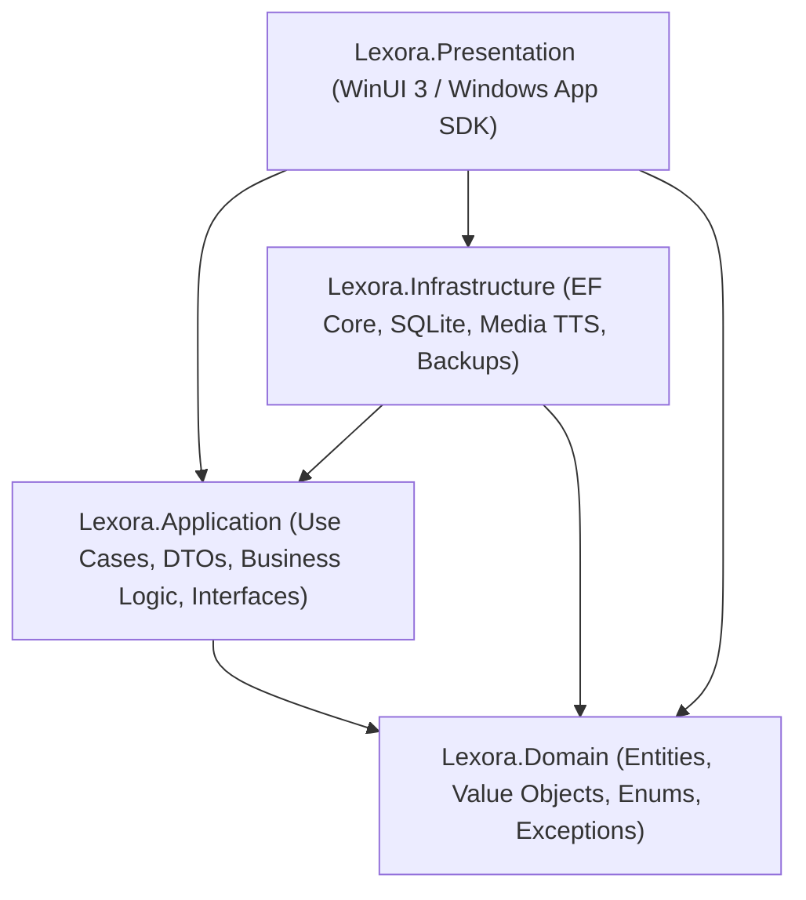

# 🏛️ AGENTS.md — Developer & AI Agent Guidelines for Lexora

> **Lexora** is a high-performance, offline-first English learning and vocabulary management desktop application designed for TOEIC, IELTS, and VSTEP exam preparation. Built with **.NET 10**, **WinUI 3 / Windows App SDK (v1.6+)**, and **Entity Framework Core 10 (SQLite)** following strict **Clean Architecture** patterns. Current Version: **v1.8.0**.

Any developer or AI agent contributing to this repository **MUST** strictly adhere to the architectural, design, code quality, and verification invariants outlined below.

---

## 1. Architectural Integrity & Boundary Rules

### 1.1 Dependency Hierarchy & Separation of Concerns
Lexora follows a strict **Clean Architecture** layout:



- **`Lexora.Domain`**: Pure .NET library. **CANNOT** reference any other project, ORM (EF Core), or UI framework. Contains core entities partitioned by domain (`Vocabulary`, `Grammar`, `Homophones`, `LearningStorage`, `Review`, `Roadmap`), domain enums (`CefrLevel`, `ExamType`, `ExamTarget`, `LearningStatus`, `RoadmapNodeType`, `NodeStatus`, `PartOfSpeech`), value objects, domain exceptions, repository contracts, and `IUnitOfWork`.
- **`Lexora.Application`**: Contains application use cases, service contracts, symmetrical DTOs, mapping extensions, and algorithm engines (SM-2, FSRS, RoadmapEngine, CAT Adaptive Quizzes). References **ONLY** `Lexora.Domain`.
- **`Lexora.Infrastructure`**: Implements repositories, EF Core DbContext, SQLite configurations, human audio caching, database backup and restoration routines, and notification providers. References `Lexora.Application` and `Lexora.Domain`.
- **`Lexora.Presentation`**: WinUI 3 desktop client containing Views, ViewModels, Converters, Custom Controls, and Presentation-specific services (Theming, Navigation, Audio playback, Shortcuts, Localization). References `Lexora.Application`, `Lexora.Infrastructure`, and `Lexora.Domain`.

### 1.2 The Absolute Presentation Layer Boundary Rule
> [!CAUTION]
> **No EF Core in Views or ViewModels**: The Presentation layer **MUST NEVER** reference `LexoraDbContext`, execute direct LINQ-to-Entities queries, or manage raw EF transactions. All data retrieval, mutations, and business rules **MUST** be orchestrated through Application services or repository contracts (`IVocabularyService`, `IGrammarService`, `IReviewService`, `IRoadmapService`, `ITestService`, `IDatabaseBackupService`).

### 1.3 Database Transactions & Schema Evolution
- **Default Database Location**: `%LocalAppData%/Lexora/data/lexora.db` (with WAL mode enabled).
- **Entity Configurations**: Fluent configurations reside exclusively in `LexoraDbContext.OnModelCreating` and dedicated configuration classes in `Lexora.Infrastructure/Data/Configurations/`. Do **NOT** scatter table or column attributes across Domain entities.
- **Single-Commit Atomic Operations**: Multi-entity mutations must be executed in a single atomic transaction (`await _unitOfWork.SaveChangesAsync(cancellationToken)`). Never perform intermediate commits that risk leaving the database in an inconsistent state.

### 1.4 Learning Roadmap & Dynamic Pathway Domain Specifications
The Interactive Learning Roadmap module models personalized, adaptive preparation tracks for TOEIC, IELTS, and VSTEP:
- **Domain Layer Purity**: Entities (`StudyRoadmap`, `RoadmapMilestone`, `RoadmapNode`) and Enums (`ExamTarget`, `RoadmapNodeType`, `NodeStatus`) are pure POCOs in `Lexora.Domain.Entities.Roadmap`. They contain zero references to EF Core, SQLite, or WinUI 3 markup.
- **Adaptive Engine Boundary**: Roadmap calculation and graph synthesis are isolated inside `Lexora.Application.Services.Roadmap.RoadmapEngine`. Score gap calibrations dynamically adjust initial SM-2 Ease Factors (EF $\in [2.0, 2.5]$) and generate serpentine 2D coordinates (`CanvasX`, `CanvasY`) for smooth visual presentation.
- **Progressive Node Unlocking**: Mastery of a node ($q \ge 3$ or $100\%$ target items learned) unlocks adjacent downstream nodes atomically in `RoadmapService.UpdateNodeProgressAsync`, adhering to the single-commit UnitOfWork invariant.
- **Repository Isolation**: Persistence is mediated strictly through `IRoadmapRepository` and EF Core Fluent configurations in `LexoraDbContext.OnModelCreating`, guaranteeing database indexing and cascade deletion integrity across Roadmap $\rightarrow$ Milestones $\rightarrow$ Nodes.

### 1.5 Domain-Driven Modular Layout Across All Layers
To prevent monolithic source file explosion, all 4 layers mirror a consistent domain taxonomy:
1. **Vocabulary & Knowledge Graph**: Terms, meanings, example sentences, contextual units, synonym/antonym graphs, and smart CSV/JSON imports.
2. **Grammar & Patterns**: Structural rules, syntactic categories, and rule suggestions.
3. **Homophones & Phonetics**: Sound-alike clusters, phonetic transcriptions, and distinction quizzes.
4. **Learning Storage**: User-curated notebooks, flashcard sets, and practice storage.
5. **Review & Spaced Repetition**: SM-2 and FSRS scheduling engines, study logs, workload forecasts, and streak calculations.
6. **Roadmap & Study Pathways**: Goal tracking, milestone progression, and dynamic graph layouts.
7. **Pronunciation & Listening Lab**: Native audio caching, Windows speech synthesis, and speed controls.
8. **Practice Tests & Adaptive Quizzes**: Computerized Adaptive Testing (CAT) and simulated exam sections.
9. **Data Health & Backup**: Automated SQLite integrity validation, backups, and safe recovery.
10. **Updates & Release Notes**: In-app user-facing markdown release logs with SemVer sorting.

---

## 2. Coding Standards & C# 13 / .NET 10 Conventions

- **Target Framework**:
  - Class Libraries (`Domain`, `Application`, `Infrastructure`, `Tests`): `net10.0`
  - Presentation Client (`Lexora.Presentation`): `net10.0-windows10.0.26100.0`
- **Modern C# 13/14 Syntax**:
  - **File-Scoped Namespaces**: All C# files must use file-scoped namespaces (e.g. `namespace Lexora.Application.Services.Vocabulary;`).
  - **Primary Constructors**: Use primary constructors for dependency injection in classes and ViewModels where applicable.
  - **Nullable Reference Types**: Enable `#nullable enable` across all projects. Do not suppress nullability warnings with blanket `!` operators; use defensive validation or explicit guard clauses (`ArgumentNullException.ThrowIfNull(...)`).
  - **Asynchronous Operations**: All I/O-bound and database methods must be asynchronous, return `Task` or `Task<T>`, accept an optional `CancellationToken cancellationToken = default`, and handle task cancellations cleanly.

### 2.1 MVVM Architecture & CommunityToolkit Conventions
- ViewModels must inherit from `CommunityToolkit.Mvvm.ComponentModel.ObservableObject`.
- Use **C# 13 partial properties** with `[ObservableProperty]` to ensure 100% WinRT / CsWinRT AOT compatibility and prevent compiler warnings:
  ```csharp
  [ObservableProperty]
  public partial string SearchQuery { get; set; } = string.Empty;
  ```
- Use `[RelayCommand]` on ViewModel methods for clean command bindings.
- ViewModels must be registered in the Microsoft Dependency Injection container with appropriate lifetimes (usually `Transient` for transient pages or `Singleton` for shared app state).

### 2.2 Partial Class Pattern for ViewModels & Complex Services
> [!TIP]
> When ViewModels or Services exceed ~250 lines or encompass multiple distinct operational aspects (e.g. Filtering, Batch Actions, Import/Export, Quiz Logic), **ALWAYS** partition them into feature-specific partial classes within their respective feature subfolders:
- **`VocabularyViewModel.cs`**: Core state, collections, selection tracking, primary lifecycle.
- **`VocabularyViewModel.Filter.cs`**: CEFR, topic, search query, and status filtering logic.
- **`VocabularyViewModel.Batch.cs`**: Multi-select bulk deletion, status mutation, and topic assignments.
- **`VocabularyViewModel.ImportExport.cs`**: CSV/JSON/Text export and smart import workflows.
- **`LocalizationService.cs`**: Core localization engine, culture switching, and indexers.
- **`LocalizationService.*.cs`**: 16 dedicated partial dictionaries divided cleanly by domain feature.

---

## 3. WinUI 3 & Fluent 2 UI/UX Guidelines

### 3.1 Zero Hardcoded Colors Invariant
> [!IMPORTANT]
> **NEVER** use hardcoded hex color strings (e.g. `#FFF4CE`, `#E6F2FB`, `#323130`, `#FFFFFF`, `#000000`) for text, backgrounds, borders, or accents in XAML or code-behind. **ALWAYS** use Fluent `{ThemeResource ...}` brushes to ensure visual fidelity across Windows Light, Dark, and High-Contrast modes.

| Visual Intent | Forbidden Hardcoded Example | Mandatory Fluent Resource Brush |
| :--- | :--- | :--- |
| Window / Page Background | `#F3F3F3` / `#202020` | `{ThemeResource LayerFillColorDefaultBrush}` |
| Primary Card Surface | `#FFFFFF` / `#2C2C2C` | `{ThemeResource CardBackgroundFillColorDefaultBrush}` |
| Secondary / Subtle Surface | `#F9F9F9` / `#1F1F1F` | `{ThemeResource SubtleFillColorSecondaryBrush}` |
| Card Border / Outline | `#E5E5E5` / `#383838` | `{ThemeResource CardStrokeColorDefaultBrush}` |
| Primary Text | `#000000` / `#FFFFFF` | `{ThemeResource TextFillColorPrimaryBrush}` |
| Secondary / Subtitle Text | `#666666` / `#A0A0A0` | `{ThemeResource TextFillColorSecondaryBrush}` |
| Tertiary / Hint Text | `#8A8A8A` / `#6E6E6E` | `{ThemeResource TextFillColorTertiaryBrush}` |
| Accent Colored Text | `#0078D4` / `#60CDFF` | `{ThemeResource AccentTextFillColorPrimaryBrush}` |
| Critical / Danger State | `#FDE7E9` / `#C50F1F` | `{ThemeResource SystemFillColorCriticalBrush}` |
| Warning / Caution State | `#FFF4CE` / `#7A5B00` | `{ThemeResource SystemFillColorCautionBrush}` |
| Success / Mastered State | `#DFF6DD` / `#107C41` | `{ThemeResource SystemFillColorSuccessBrush}` |

### 3.2 Responsive Layouts & Anti-Clutter Design
- **Responsive Width Budgeting**: Never define rigid fixed widths (e.g. `Width="680"`) on cards, dialogs, or panels that could overflow on 1366x768 or non-maximized screens. Use `MaxWidth` with `HorizontalAlignment="Stretch"`.
- **Master-Detail Layouts**: Use flexible grid column proportions (e.g. `ColumnDefinitions="320,*"` or `ColumnDefinitions="360,*"`) and wrap all text elements (`TextWrapping="Wrap"`) in detail panes to prevent layout clipping and button collisions.
- **Adaptive Grids**: For collections and cards, use `ItemsRepeater` with a `UniformGridLayout` instead of horizontally scrolling fixed-width lists.
- **Scroll Isolation**: Always wrap tall pages in a `ScrollViewer` with `VerticalScrollBarVisibility="Auto"` and `HorizontalScrollBarVisibility="Disabled"` unless horizontal panning is explicitly required.

### 3.3 WinUI 3 Dialog Architecture & Safe Chaining
- Always set `dialog.XamlRoot = this.XamlRoot;` before displaying any `ContentDialog`.
- Position validation feedback at the **very top** of the dialog using an `InfoBar` so error messages are visible without scrolling.
- **Sequential Dialog Chaining Invariant**: WinUI 3 throws an `InvalidOperationException` (*"An async operation was already in progress"*) if a dialog is shown while another dialog is in the middle of closing. Always insert `await Task.Yield();` before opening the next dialog:
  ```csharp
  await firstDialog.ShowAsync();
  await Task.Yield(); // Allows the visual tree to clean up the closed dialog
  await secondDialog.ShowAsync();
  ```

### 3.4 WinUI 3 Markup Compilation & Scoping Nuances
- **DataTemplate Scope**: WinUI 3 `{x:Bind}` within a `DataTemplate` cannot bind to elements outside the item's `DataType` via `ElementName` or page properties. Keep templates bound directly to item DTO properties.
- **Flyout Scope**: Elements inside a `<Flyout>` or `<MenuFlyout>` cannot bind to page properties without triggering markup compiler exceptions (`Xaml Internal Error error WMC9999`). Use code-behind event handlers or placement in the main visual tree for complex bound controls.
- **Assembly Qualification**: When accessing application resources or singletons in code-behind, use `App.Current` rather than unqualified `Application.Current` to avoid ambiguity with `Lexora.Application`.
- **Anti-WMC9999 Indexer Rule**: WinUI 3 XAML compiler (`XamlCompiler.exe`) does not support string indexers in `{x:Bind}` (e.g. `Loc['Key']` causes parser null reference exception `WMC9999`). Always expose method bindings `{x:Bind Loc.GetString('Key')}` or typed DTO properties.
- **ConverterParameter Invariant**: Never define `ConverterParameter` without an explicit `Converter={...}`. Never specify `TargetNullValue` on non-nullable value types (`double`, `int`).

### 3.5 Fluent Motion, Visual Roadmap Canvas & Smooth Rendering
- **Connected Animation Lifecycle**:
  - Always use `ConnectedAnimationService.GetForCurrentView()` to bridge navigation transitions between visual nodes and detail views:
    ```csharp
    // Trigger on selection
    var anim = ConnectedAnimationService.GetForCurrentView();
    anim.PrepareToAnimate("nodeTransition", rootElement);
    ```
- **Virtual Spline & Track Generation**:
  - Never instantiate hundreds of discrete line controls or heavy shapes in XAML. Use lightweight `Path` elements with `PathGeometry` and cubic `BezierSegment` connectors calculated from node center coordinates:
    $cp_1 = (x_0, \frac{y_0 + y_1}{2}), \quad cp_2 = (x_1, \frac{y_0 + y_1}{2})$.
- **Viewport Layout Budgeting**:
  - All large custom canvases (`RoadmapCanvas`, `KnowledgeGraphCanvas`) must be hosted inside a scroll-isolated `ScrollViewer` (`HorizontalScrollBarVisibility="Auto"`, `VerticalScrollBarVisibility="Auto"`), dynamically adjusting canvas dimensions based on $\max(Y) + 200$.
  - Page root containers and primary workspaces must stretch responsively with `HorizontalAlignment="Stretch"` and consistent margins/padding (e.g. `Padding="24"`) without arbitrary top-level `MaxWidth` constraints that cause dead whitespace or asymmetrical left-heavy clipping on 1080p+ widescreen monitors.

---

## 4. Real-Time Multi-Language Localization (i18n)

### 4.1 Modular Architecture of `ILocalizationService`
Lexora includes a high-performance, offline, dual-dictionary localization system supporting **Tiếng Việt (`vi-VN`)** and **English (`en-US`)**:
- Service interface: `ILocalizationService`
- Implementation: `LocalizationService` registered as a `Singleton` in DI.
- Key naming convention: `Category_Descriptor` (e.g. `Nav_Dashboard`, `Vocab_AddWord`, `Review_RatingGood`, `Settings_Theme`).

### 4.2 Partial Class Dictionary Partitioning
To guarantee zero dictionary merge conflicts, optimal code maintainability, and clean domain boundaries, `LocalizationService` is partitioned into **18 domain partial classes** (plus core `LocalizationService.cs`) in `src/Lexora.Presentation/Services/Localization/`:
1. `LocalizationService.cs`: Core dictionary engine, active culture state, `SetLanguage`, and string indexer/resolver.
2. `LocalizationService.Common.cs`: Global actions (Save, Cancel, Delete, Confirm, Loading, Success, Error).
3. `LocalizationService.Dashboard.cs`: Dashboard metrics, streak banners, daily goals, and exam countdowns.
4. `LocalizationService.Dialogs.cs`: Modal dialog headers, confirmation prompts, and progress messages.
5. `LocalizationService.Grammar.cs`: Grammar points, CEFR grammar levels, structural formulas, and notes.
6. `LocalizationService.Help.cs`: Help center, FAQs, keyboard shortcuts reference, and feedback.
7. `LocalizationService.Homophones.cs`: Sound-alike pairs, IPA comparisons, and distinction notes.
8. `LocalizationService.KnowledgeGraph.cs`: Graph nodes, semantic links, clustering, and visual filters.
9. `LocalizationService.ListeningLab.cs`: Voice accents (US/UK), audio speeds, and dictation controls.
10. `LocalizationService.MemoryTips.cs`: Memory tips, mnemonics, and exam strategies.
11. `LocalizationService.Navigation.cs`: Shell navigation menu items, sidebar titles, and header breadcrumbs.
12. `LocalizationService.Phrases.cs`: Conversation phrases, registers, dialogues, and scenario tags.
13. `LocalizationService.Review.cs`: Spaced repetition ratings (Again, Hard, Good, Easy), cards, and session summaries.
14. `LocalizationService.Roadmap.cs`: Milestones, target exam scores (TOEIC/IELTS/VSTEP), and adaptive nodes.
15. `LocalizationService.Settings.cs`: Appearance themes, audio voice selection, database backup/restore, and updates.
16. `LocalizationService.SmartImport.cs`: Intelligent CSV/JSON/Text parser labels, column mapping, and import preview.
17. `LocalizationService.Storage.cs`: Learning notebooks, personalized tags, and custom memory categories.
18. `LocalizationService.Test.cs`: Mock test modes, adaptive quiz questions, countdown timers, and score reports.
19. `LocalizationService.Vocabulary.cs`: Word definitions, phonetic transcriptions, CEFR levels, and word filters.

> [!IMPORTANT]
> Whenever adding or altering user-facing text, developers and agents **MUST** add both `vi-VN` and `en-US` entries to the relevant partial file and verify parity using the script:
> `powershell -ExecutionPolicy Bypass -File .agents/skills/i18n-localization-sync/scripts/sync_localization.ps1`

### 4.3 Dynamic Real-Time Switching Without App Restart
When the user toggles the application language in `SettingsPage`:
1. `ILocalizationService.SetLanguage(langCode)` updates `CultureInfo.CurrentCulture` and `CultureInfo.CurrentUICulture`, then raises the `LanguageChanged` event.
2. `MainWindow.xaml.cs` handles `LanguageChanged` to update the native window title and custom Fluent titlebar.
3. `ShellPage.xaml.cs` handles `LanguageChanged` to update all `NavigationViewItem` labels, global search placeholders, and re-navigates `ContentFrame` to reload the active page in the new language seamlessly.
4. Active views bind text labels using `{x:Bind Loc.GetString('KeyName')}` or `{x:Bind Loc['KeyName']}`.

---

## 5. Spaced Repetition (SM-2 & FSRS) Integrity

### 5.1 The SM-2 Mathematical Specification
All spaced repetition calculations must be routed through `ISpacedRepetitionEngine` (`Sm2SpacedRepetitionEngine` or `FsrsSpacedRepetitionEngine`):
- **Rating Scale**:
  - `0` or `1`: Again (Complete blackout or incorrect recall)
  - `2`: Hard (Correct response with significant hesitation)
  - `3`: Good (Correct response with standard recall effort)
  - `4`: Easy (Perfect, instantaneous recall)
- **Ease Factor (EF) Floor**:
  $$EF' = EF + (0.1 - (4 - q) \times (0.08 + (4 - q) \times 0.02))$$
  The Ease Factor must **never** drop below 1.3 ($EF \ge 1.3$).
- **Interval Progression ($I$)**:
  - For $q < 2$ (Again / Lapse): $I = 1$ day, Repetitions = 0.
  - For $q \ge 2$:
    - Repetition 1: $I = 1$ day
    - Repetition 2: $I = 6$ days
    - Repetition $n > 2$: $I_n = \lceil I_{n-1} \times EF \rceil$ days.

### 5.2 Review Transactions & Concurrency Safety
- Every review submission must atomically create a `StudyLog` entry, update the `Word` entity's interval, ease factor, and due date, and call `IReviewRepository.UpdateStreakAsync`.
- Review card rating buttons in the UI must be guarded against rapid double-clicks (e.g. using `IsSubmitting` concurrency flags) to prevent re-entrant rating submissions.

---

## 6. Security, IO & Data Protection Invariants

### 6.1 Path Traversal Defense
> [!WARNING]
> Any service handling file exports, database backups, or cached audio files **MUST** sanitize filenames using an alphanumeric whitelist and verify canonical paths via `SafePathHelper`:
> ```csharp
> var fullPath = SafePathHelper.EnsureSafePath(baseDirectory, userFilename);
> ```

### 6.2 SQLite Backup & Restoration Integrity
1. **Magic Header Verification**: Before restoring any `.db` file, verify that the first 16 bytes match the SQLite header string:
   `"SQLite format 3\0"` (`0x53, 0x51, 0x4C, 0x69, 0x74, 0x65, 0x20, 0x66, 0x6F, 0x72, 0x6D, 0x61, 0x74, 0x20, 0x33, 0x00`).
2. **Connection Pool Flushing**: Prior to replacing the active database file, execute `SqliteConnection.ClearAllPools()` and delete any active write-ahead lockfiles (`lexora.db-wal`, `lexora.db-shm`).

### 6.3 Import Payload Limits & De-duplication
- All CSV and JSON import parsers must enforce a 20MB ceiling on input files.
- Incoming records must be normalized (trimmed, lowercased terms) and de-duplicated against existing database records prior to batch insertion.

---

## 7. Audio & Media Integration (TTS & Human Voice)

- **Two-Tier Audio Architecture**:
  1. **Tier 1 (Cached Human Audio)**: High-fidelity native audio files stored locally in `%LocalAppData%/Lexora/audio/cache/`, indexed by term hash (`SHA256`).
  2. **Tier 2 (Windows Speech Synthesis Fallback)**: Built-in `Windows.Media.SpeechSynthesis.SpeechSynthesizer` with UK (`en-GB`) and US (`en-US`) voice selection.
- **Playback Control**: Support configurable playback speeds (`0.75x`, `1.0x`, `1.25x`, `1.5x`) and ensure any ongoing audio playback is safely stopped before initiating a new playback stream.

---

## 8. Build, Quality Gates & Verification Protocol

Before completing any task, committing code, or declaring an issue resolved, developers and AI agents **MUST** execute and pass the following quality gates in PowerShell:

```powershell
# 1. Build the entire solution (Must finish with 0 warnings and 0 errors)
dotnet build Lexora.slnx -v q /clp:ErrorsOnly

# 2. Run all unit and integration test suites (All 617 tests MUST pass)
dotnet test Lexora.slnx --no-build

# 3. Packaging & Installer Verification (When modifying deployment scripts)
powershell -ExecutionPolicy Bypass -File ./build-installer.ps1 -Version "1.8.0"
```

### Current Quality Gate Benchmark
- **Build Status**: `0 Warning(s)`, `0 Error(s)`.
- **Test Suite**: **617 / 617 Tests Passing** (540 Unit Tests + 77 Integration Tests, 0 Failed, 0 Skipped).
- **Architecture Integrity**: Clean Architecture invariants strictly satisfied with 0 boundary violations.

### 8.1 Release Notes Log & User-Facing Documentation Protocol (`release-notes/`)
> [!IMPORTANT]
> **Mandatory Invariant for Every New Release**: Whenever a new application version is created, tagged, or bumped, developers and AI agents **MUST** create a dedicated Markdown release notes file in `release-notes/vX.Y.Z.md` and verify its presentation in the desktop client.

1. **Folder Architecture & File Naming**:
   - Location: `release-notes/` at the repository root.
   - Naming convention: `vX.Y.Z.md` (e.g. `v1.7.0.md`, `v1.6.1.md`, `v1.6.0.md`).
   - Template: Must follow [`release-notes/template.md`](file:///d:/LEARN/Lexora/release-notes/template.md).
2. **Authoring Standard (User-Centric & Markdown)**:
   - **Simple, Concise, Easy to Understand**: Focus strictly on learner benefits and visible capabilities. Avoid internal class names, repository interfaces, or git commit diffs.
   - **Standard Markdown Structure**:
     - `# Lexora vX.Y.Z — [Tiêu đề bản phát hành / Release Title]`
     - `> Ngày phát hành: YYYY-MM-DD | Phiên bản: X.Y.Z`
     - `## 🌟 Điểm nổi bật (Highlights)`: 1-2 sentence executive overview.
     - `## 🚀 Tính năng mới (New Features)`: Bullet points highlighting value for English exam preparation (TOEIC, IELTS, VSTEP).
     - `## ⚡ Cải tiến & Trải nghiệm (Improvements & UX)`: Performance, layout responsiveness, Fluent 2 visual clarity, shortcuts.
     - `## 🛠️ Sửa lỗi & Độ ổn định (Bug Fixes & Stability)`: Resolved issues, crash prevention, data security.
     - `## 🇬🇧 English Summary`: Bilingual parity for global and international users.
3. **In-App Release Notes Viewer Integration**:
   - The application bundles `release-notes/` via `Lexora.Presentation.csproj` Content copy (`CopyToOutputDirectory="PreserveNewest"`).
   - Domain contract `IReleaseNotesService` and infrastructure implementation `ReleaseNotesService` read and parse markdown notes offline with descending semantic version sorting.
   - Native WinUI 3 dialog `ReleaseNotesLogDialog` combines with `ReleaseNotesRenderer` to render markdown with Segoe Fluent Icons, version selection, and high-contrast adaptability.
   - Accessible from both `SettingsPage` (under Software Updates: "Nhật ký phát hành") and `HelpPage` (Help Center hero action).

---

## 9. Repository Layout & File Navigation Map

```
Lexora/
├── Lexora.slnx                               # Solution file (.NET 10 slnx format)
├── Directory.Build.props                     # Global solution assembly versioning (v1.8.0)
├── AGENTS.md                                 # Developer & AI Agent master guidelines
├── CHANGELOG.md                              # High-level version history (Semantic Versioning 2.0.0)
├── PROGRESS.md                               # Project progress tracking and milestones
├── README.md                                 # User-facing overview & feature breakdown
├── ROADMAP.md                                # Strategic roadmap overview
├── build-installer.ps1                       # Inno Setup installer packaging script
├── build-release.ps1                         # Production release build script
├── .agents/                                  # AI Agent Personas, Skills, Rules & Configurations
│   ├── hooks.json                            # Antigravity IDE custom hooks & lifecycle triggers
│   ├── personas/                             # Specialized subagent roles
│   │   ├── architect.md                      # Clean Architecture & dependency flow guardian
│   │   ├── fluent-ui-designer.md             # Fluent 2 UI/UX, accessibility & ThemeResource specialist
│   │   ├── qa-engineer.md                    # Zero-warning build, automated testing & regression auditor
│   │   └── security-auditor.md               # SQLite safety, path traversal & data protection guardian
│   ├── rules/                                # Modular workspace rules (Antigravity discovered)
│   │   ├── 01-clean-architecture.md          # Clean Architecture boundaries & DI patterns
│   │   ├── 02-csharp-dotnet-standards.md     # C# 13, .NET 10, MVVM and async standards
│   │   ├── 03-winui3-fluent-design.md        # Fluent 2 UI/UX, brushes, and layouts
│   │   ├── 04-security-and-data-protection.md# Path traversal, backups, and file safety
│   │   ├── 05-spaced-repetition-sm2.md       # SM-2 formula, intervals, and streak engine
│   │   ├── 06-testing-and-verification.md    # Test suite requirements & CI verification
│   │   ├── 07-agent-token-efficiency-and-accuracy.md # AI Agent token economy & precision protocol
│   │   ├── 08-release-notes-and-versioning.md# User-facing markdown release notes in release-notes/
│   │   └── README.md                         # Rules index & guide
│   └── skills/                               # Standardized, executable agent skills
│       ├── clean-architecture-lint/          # Architecture boundaries static analysis
│       ├── changelog-bump/                   # Keep-a-Changelog fragment creation & release consolidation
│       ├── db-migration-check/               # SQLite schema, WAL mode & backup safety integrity
│       ├── i18n-localization-sync/           # Bilingual (vi-VN / en-US) dictionary & XAML parity audit
│       ├── lexora-quality-audit/             # Clean build (0 warnings) and test suite verification
│       ├── release-package-prep/             # Version synchronization & release packaging readiness
│       ├── roadmap-visual-builder/           # Interactive roadmap canvas, Bézier splines & adaptive pathways
│       ├── sm2-algorithm-verify/             # Spaced Repetition (SM-2) engine invariant verification
│       └── winui3-fluent-audit/              # Fluent 2 zero-hardcoded-colors & responsive layout audit
├── changelog/                                # Changelog fragment management
│   ├── unreleased/                           # PR/feature changelog fragments
│   └── archive/                              # Archived version changelogs
├── release-notes/                            # User-facing Release Notes log (Markdown format per version)
│   ├── README.md                             # Release notes guidelines & authoring rules
│   ├── template.md                           # Standard release note markdown template
│   └── v1.8.0.md                             # Current release notes log (v1.8.0, v1.7.0, v1.6.1, ...)
├── docs/                                     # Architecture, specs & documentation hub
│   ├── adr/                                  # Architecture Decision Records (ADRs)
│   ├── architecture.md                       # System architecture & Clean Architecture layout
│   ├── api_and_services.md                   # Application services and DTO contracts
│   ├── database_schema.md                    # SQLite schema, tables & indexes
│   ├── spaced_repetition.md                  # SM-2 & FSRS algorithm specifications
│   └── testing_and_qa.md                     # Automated test suites guide
├── roadmap/                                  # Strategic roadmap & backlog tracking
│   ├── milestones.md                         # Milestone definitions, releases & exit criteria
│   └── backlog.md                            # Categorized backlog & acceptance criteria
├── src/
│   ├── Lexora.Domain/                        # Pure domain layer (Entities, Enums, Exceptions, Repositories)
│   │   ├── Common/                           # BaseEntity, ValueObject base contracts
│   │   ├── Entities/                         # Domain-grouped POCO entities
│   │   │   ├── Grammar/                      # GrammarRule, GrammarExample
│   │   │   ├── Homophones/                   # HomophoneGroup, HomophoneItem
│   │   │   ├── LearningStorage/              # LearningStorageItem
│   │   │   ├── MemoryTips/                   # MemoryTip
│   │   │   ├── Phrases/                      # ConversationPhrase
│   │   │   ├── Review/                       # ReviewCard, StudyLog, StudySession, UserStreak
│   │   │   ├── Roadmap/                      # StudyRoadmap, RoadmapMilestone, RoadmapNode
│   │   │   └── Vocabulary/                   # Word, WordMeaning, ExampleSentence, Topic, ExamTag, WordTopic, WordExamTag
│   │   ├── Enums/                            # CefrLevel, ExamType, ExamTarget, RoadmapNodeType, NodeStatus, LearningStatus, PartOfSpeech, etc.
│   │   ├── Exceptions/                       # DomainValidationException, EntityNotFoundException, SecurityException
│   │   └── Interfaces/                       # Domain repository contracts (IVocabularyRepository, IReviewRepository, IRoadmapRepository, etc.) & IUnitOfWork
│   ├── Lexora.Application/                   # Application layer (Services, DTOs, Use Cases, Interfaces)
│   │   ├── Common/                           # MappingExtensions, JsonConverters, SafePathHelper, ProgressThrottler
│   │   ├── DTOs/                             # Domain-symmetrical DTO models
│   │   │   ├── Audio/                        # ListeningLabDtos, VoiceDescriptor
│   │   │   ├── Backup/                       # BackupMetadata, DataHealthDtos
│   │   │   ├── Dashboard/                    # DashboardSummaryDto, WorkloadForecastDto
│   │   │   ├── Grammar/                      # GrammarRuleDto
│   │   │   ├── Homophones/                   # HomophoneGroupDto, HomophoneItemDto, HomophoneSmartImportDtos
│   │   │   ├── KnowledgeGraph/               # KnowledgeGraphDtos
│   │   │   ├── LearningStorage/              # LearningStorageDtos
│   │   │   ├── MemoryTips/                   # MemoryTipDtos
│   │   │   ├── Phrases/                      # ConversationPhraseDtos
│   │   │   ├── Preferences/                  # UserPreferences
│   │   │   ├── Review/                       # ReviewCardDto, LearningIntelligenceDtos, SmartReviewDtos, StudyAdviceDto, StudyPlannerDtos
│   │   │   ├── Roadmap/                      # RoadmapDtos, MilestoneDto, StudyRoadmapDto
│   │   │   ├── Search/                       # SmartSearchDtos
│   │   │   ├── Statistics/                   # AnalyticsDTOs, ProgressReport
│   │   │   ├── Test/                         # TestDTOs, AdaptiveQuizDtos
│   │   │   ├── Updates/                      # UpdateDtos
│   │   │   └── Vocabulary/                   # WordDto, ExportModels, SmartImportDtos
│   │   ├── Interfaces/                       # Domain-symmetrical service interfaces
│   │   │   ├── Audio/                        # IAudioPlayerService, IAudioStorageService, IPronunciationListeningLabService, IVoiceProvider
│   │   │   ├── Backup/                       # IDatabaseBackupService, IDataHealthService
│   │   │   ├── Grammar/                      # IGrammarService, IGrammarExportImportService, IGrammarSuggestionService
│   │   │   ├── Homophones/                   # IHomophoneService, IHomophoneExportImportService
│   │   │   ├── KnowledgeGraph/               # IVocabularyKnowledgeGraphService, IKnowledgeGraphExportImportService
│   │   │   ├── LearningStorage/              # ILearningStorageService
│   │   │   ├── MemoryTips/                   # IMemoryTipService
│   │   │   ├── Phrases/                      # IConversationPhraseService
│   │   │   ├── Preferences/                  # IUserPreferencesService
│   │   │   ├── Review/                       # IReviewService, IReviewReminderService, IStudyAdvisorService, IStudyPlannerService
│   │   │   ├── Roadmap/                      # IRoadmapService
│   │   │   ├── Search/                       # IFuzzySearchService, ISmartSearchService, ISmartSearchCacheService
│   │   │   ├── Statistics/                   # IStatisticsService
│   │   │   ├── Test/                         # ITestService, IAdaptiveQuizService
│   │   │   ├── Updates/                      # IUpdateService, IReleaseNotesService
│   │   │   └── Vocabulary/                   # IVocabularyService, IExportImportService, IVocabularySuggestionService
│   │   ├── Services/                         # Domain-symmetrical service implementations
│   │   │   ├── Common/                       # ProgressThrottler
│   │   │   ├── Grammar/                      # GrammarService, GrammarExportImportService, GrammarSuggestionService
│   │   │   ├── Homophones/                   # HomophoneService, HomophoneExportImportService
│   │   │   ├── KnowledgeGraph/               # VocabularyKnowledgeGraphService, KnowledgeGraphExportImportService
│   │   │   ├── LearningStorage/              # LearningStorageService
│   │   │   ├── MemoryTips/                   # MemoryTipService
│   │   │   ├── Phrases/                      # ConversationPhraseService
│   │   │   ├── Pronunciation/                # PronunciationListeningLabService, PronunciationVoiceResolver
│   │   │   ├── Review/                       # ReviewService, StudyAdvisorService, StudyPlannerService
│   │   │   ├── Roadmap/                      # RoadmapService, RoadmapEngine
│   │   │   ├── Search/                       # FuzzySearchService, SmartSearchService, SmartSearchCacheService
│   │   │   ├── Statistics/                   # StatisticsService
│   │   │   ├── Test/                         # TestService, AdaptiveQuizService
│   │   │   ├── Updates/                      # UpdateService, ReleaseNotesService
│   │   │   └── Vocabulary/                   # VocabularyService, ExportImportService, VocabularySuggestionService
│   │   └── SpacedRepetition/                 # ISpacedRepetitionEngine, Sm2SpacedRepetitionEngine, FsrsSpacedRepetitionEngine, SpacedRepetitionEngineFactory
│   ├── Lexora.Infrastructure/                # Infrastructure layer (EF Core, Audio, SQLite, Notifications)
│   │   ├── Data/                             # LexoraDbContext, SqliteDatabaseInitializer, UnitOfWork, Configurations/
│   │   ├── Repositories/                     # VocabularyRepository, ReviewRepository, RoadmapRepository, LearningStorageRepository, GrammarRepository, HomophoneRepository, KnowledgeGraphRepository
│   │   └── Services/                         # Modular infrastructure services
│   │       ├── Audio/                        # AudioStorageService (SHA256 human audio cache)
│   │       ├── Backup/                       # DatabaseBackupService (SQLite integrity & restore)
│   │       ├── Notifications/                # ReviewReminderService (Windows toast reminders)
│   │       ├── Preferences/                  # UserPreferencesService (Local JSON storage)
│   │       └── Updates/                      # ReleaseNotesService, UpdateService
│   └── Lexora.Presentation/                  # WinUI 3 desktop client (Windows App SDK)
│       ├── Assets/                           # App icons, splash screens, brand assets
│       ├── Converters/                       # BoolToVisibility, HeatmapLevelToBrush, EnumToDisplayName, etc.
│       ├── Helpers/                          # ReleaseNotesRenderer, UI helper routines
│       ├── Services/                         # Presentation services & contracts
│       │   ├── Audio/                        # AudioPlayerService, WindowsVoiceProvider
│       │   ├── Extensions/                   # ResourceExtensions
│       │   ├── Localization/                 # LocalizationService (Core engine) + 18 domain partial classes:
│       │   │                                 # (.Common, .Dashboard, .Dialogs, .Grammar, .Help, .Homophones, .KnowledgeGraph,
│       │   │                                 #  .ListeningLab, .MemoryTips, .Navigation, .Phrases, .Review, .Roadmap, .Settings, .SmartImport, .Storage, .Test, .Vocabulary)
│       │   ├── Navigation/                   # NavigationService, PageService
│       │   ├── Notifications/                # InAppNotificationService (Toast overlays)
│       │   ├── Orchestration/                # PresentationOrchestrationService
│       │   ├── Shortcuts/                    # KeyboardShortcutService
│       │   └── Theming/                      # ThemeSelectorService (Mica backdrop, Dark/Light modes)
│       ├── Strings/                          # Localization resource assets
│       ├── Themes/                           # Fluent 2 XAML styles, brushes & ThemeResources
│       ├── ViewModels/                       # Feature-partitioned MVVM ViewModels (Partial Class pattern)
│       │   ├── Common/                       # BaseViewModel, NavigationItemViewModel
│       │   ├── Dashboard/                    # DashboardViewModel
│       │   ├── Grammar/                      # GrammarViewModel (.Editor, .Filter)
│       │   ├── Help/                         # HelpViewModel
│       │   ├── Homophones/                   # HomophonesViewModel (.Editor, .ImportExport)
│       │   ├── KnowledgeGraph/               # KnowledgeGraphViewModel (.Interaction)
│       │   ├── LearningStorage/              # LearningStorageViewModel (.Operations, .Practice)
│   │   │   ├── MemoryTips/                   # MemoryTipsViewModel
│   │   │   ├── Phrases/                      # PhrasesViewModel
│       │   ├── Review/                       # ReviewViewModel (.Rating, .Typing)
│       │   ├── Roadmap/                      # RoadmapViewModel (.Generation)
│       │   ├── Settings/                     # SettingsViewModel (.Backup, .Updates)
│       │   ├── Test/                         # TestViewModel (.Quiz, .Results, TestOptionItem)
│       │   └── Vocabulary/                   # VocabularyViewModel (.Batch, .Filter, .ImportExport, SelectableWordItem)
│       └── Views/                            # Feature-grouped XAML Views & Dialogs
│           ├── Common/                       # ShellPage, SplashScreenOverlay, ToastOverlayControl, OperationProgressDialog
│           ├── Dashboard/                    # DashboardPage, DataHealthCenterDialog, StudyPlannerDialog
│           ├── Grammar/                      # GrammarPage, GrammarEditorDialog
│           ├── Help/                         # HelpPage, ReleaseNotesLogDialog
│           ├── Homophones/                   # HomophonesPage, HomophoneEditorDialog
│           ├── KnowledgeGraph/               # KnowledgeGraphPage, KnowledgeGraphDialog, KnowledgeGraphImportDialog
│           ├── LearningStorage/              # LearningStoragePage
│   │   │   ├── MemoryTips/                   # MemoryTipsPage, MemoryTipEditorDialog
│   │   │   ├── Phrases/                      # PhrasesPage, PhraseEditorDialog
│           ├── Review/                       # ReviewPage, ListeningLabDialog
│           ├── Roadmap/                      # RoadmapPage
│           ├── Settings/                     # SettingsPage, UpdateDetailsDialog
│           ├── Test/                         # TestPage
│           └── Vocabulary/                   # VocabularyPage, WordEditorDialog, TopicEditorDialog, AssignTopicDialog, SmartImportDialog
├── tests/
│   ├── Lexora.Tests.Unit/                    # 540 xUnit Unit Tests (Roadmap, SM-2, FSRS, Listening Lab, CAT, MemoryTips, Phrases, DTOs, Services)
│   └── Lexora.Tests.Integration/             # 77 xUnit Integration Tests (SQLite in-memory, Repositories, Workflows)
└── .github/
    └── workflows/
        ├── agent-quality-gate.yml            # CI build & automated test quality gate
        └── changelog-enforcer.yml            # CI check enforcing unreleased changelog fragment
```

---

## 10. Pull Request & Agent Pre-Flight Checklist

Before marking any task as complete, verify:

- [ ] **Clean Architecture Preserved**: No direct EF Core references or DbContext calls in `Lexora.Presentation`.
- [ ] **Zero Hardcoded Colors**: All UI elements strictly use Fluent `{ThemeResource ...}` brushes.
- [ ] **Responsive & Non-Clipping**: All grids, cards, and dialogs adapt cleanly to small viewports without horizontal clipping.
- [ ] **Bilingual Localization**: All newly added user-facing strings are added to both `vi-VN` and `en-US` dictionaries in the corresponding `LocalizationService.<Domain>.cs` partial file.
- [ ] **Partial Class Architecture Adhered**: Large ViewModels and services adhere to the partial class convention without monolithic growth.
- [ ] **Dialog Safety**: All `ContentDialog` calls set `XamlRoot` and precede sequential dialogs with `await Task.Yield()`.
- [ ] **Data Security**: File paths are validated against directory traversal via `SafePathHelper`; database operations commit atomically through `IUnitOfWork`.
- [ ] **SM-2 / FSRS Engine Compliance**: Spaced repetition logic preserves $EF \ge 1.3$ and logs study records.
- [ ] **Token Economy Enforced**: Only targeted file slices viewed (`read_file` with ranges); in-place diff edits (`edit_file`) instead of full-file overwrites; quiet build flags (`-v q /clp:ErrorsOnly`).
- [ ] **Anti-Hallucination & Type Reusability**: Existing types and services verified before declaring new contracts; Clean Architecture cascade strictly followed.
- [ ] **Release Notes Log Created**: User-friendly, concise markdown release note created in `release-notes/vX.Y.Z.md` following `template.md` and verified in `ReleaseNotesLogDialog`.
- [ ] **Clean Build**: `dotnet build Lexora.slnx -v q /clp:ErrorsOnly` completes with **0 warnings and 0 errors**.
- [ ] **All Tests Green**: `dotnet test Lexora.slnx --no-build` runs and passes **all 617 tests** (540 Unit + 77 Integration).

---

## 11. AI Agent Token Optimization & Precision Protocol (Gemini & Antigravity)

> [!IMPORTANT]
> To maximize inference efficiency, preserve the context window, and guarantee zero-defect code generation, AI agents (e.g. Gemini 2.5 / 3.x Flash & Pro in Antigravity) **MUST** strictly adhere to the following operational protocols:

### 11.1 Token Conservation & Context Window Economy
1. **Targeted Inspection (`read_file`)**:
   - **NEVER** dump entire files (>150 lines). Pinpoint symbols and line numbers first, then read only the relevant 30–60 line block using `StartLine` and `EndLine`.
   - Never re-read files that were already retrieved earlier in the current conversation context.
2. **Precision Diffs (`edit_file`)**:
   - **NEVER** overwrite entire existing files just to apply modifications. Use atomic replacement chunks with minimal anchor lines (1–2 lines) to minimize completion tokens and prevent accidental truncation of imports or comments.
   - Never replace entire classes or large blocks just to modify a single line or variable.
3. **Quiet & Paged Terminal Commands (`run_command`)**:
   - Keep build logs silent on success: `dotnet build Lexora.slnx -v q /clp:ErrorsOnly` (0 tokens returned on clean build).
   - When iterating on a feature or fixing a bug, do **NOT** run the full test suite repeatedly. Target specific tests:
     `dotnet test --filter "FullyQualifiedName~<TargetClass>" --logger "console;verbosity=minimal"`
   - Always run git commands with compact flags (`git status -s`, `git diff --stat`, `git log -n 5 --oneline`).
4. **High-Density, Direct Communication**:
   - Provide direct solutions with concise architectural explanations and markdown links to touched files `[FileName](file:///...)`. Avoid re-echoing the user's prompt or repeating large blocks of unmodified code in chat.

### 11.2 Precision Feature Implementation & Zero Hallucination
1. **5-Step Execution Cycle**:
   - `Locate` $\rightarrow$ `Inspect slice` $\rightarrow$ `Minimal Diff` $\rightarrow$ `Build Check (dotnet build -v q /clp:ErrorsOnly)` $\rightarrow$ `Targeted Test (dotnet test --filter)`.
2. **Verify Before Declaring Abstractions**:
   - Always search `Lexora.Domain` and `Lexora.Application` first before writing any new entity, DTO, interface, or converter. Reuse existing types to keep domain contracts clean.
3. **Strict Cascade of Changes**:
   - Always implement in dependency order: `Domain` $\rightarrow$ `Application` $\rightarrow$ `Infrastructure` $\rightarrow$ `Presentation`. Never import presentation namespaces into business or data layers.
4. **C# 13 / .NET 10 Idioms**:
   - Always declare observable properties as C# 13 partial properties:
     `[ObservableProperty] public partial string MyProperty { get; set; }`
   - Use primary constructors for dependency injection across classes and ViewModels.
   - Propagate `CancellationToken cancellationToken = default` through all async database and I/O chains.
   - Use defensive null checks (`ArgumentNullException.ThrowIfNull(...)`) rather than blanket `!` suppression.
5. **WinUI 3 & Fluent 2 Framework Specifics**:
   - Never use raw hex colors (`#FFFFFF`, `#000000`). Use `{ThemeResource ...}` brushes exclusively.
   - Synchronize all UI strings into both `vi-VN` and `en-US` in the matching `LocalizationService.<Domain>.cs` partial file.
   - Always set `XamlRoot` and handle dialog chaining with `await Task.Yield()`.
   - Dispatch background UI mutations through `DispatcherQueue.TryEnqueue`.
   - Avoid `{x:Bind}` out of scope in `DataTemplate` or `MenuFlyout` (prevents compiler `WMC9999`).
6. **Mandatory Build & Test Verification**:
   - Always execute `dotnet build Lexora.slnx -v q /clp:ErrorsOnly` after editing code to verify **0 warnings and 0 errors**.
   - Run relevant tests to confirm zero functional regression before presenting the solution.
7. **Surgical Error Recovery**:
   - If a build fails, inspect only the $\pm 5$ lines surrounding the error line. Fix the exact type or syntax mismatch; never rewrite the entire file in panic.

### 11.3 Self-Skill Generation Protocol (Antigravity & Project Skills)
When encountering complex, recurring engineering challenges (e.g. WinUI 3 markup compilation exceptions, SQLite migration locks, Canvas Bézier geometry performance, or specialized spaced repetition tuning), AI agents **MUST** encapsulate the verified solution into a standardized, reusable skill in `.agents/skills/<skill-name>/`:

1. **Standard Skill Directory Structure**:
   ```
   .agents/skills/<skill-name>/
   ├── SKILL.md       # (Mandatory) YAML frontmatter metadata, trigger conditions, architectural invariants & workflow
   ├── scripts/       # (Optional) Automated execution/verification scripts (PowerShell .ps1, C# script)
   ├── examples/      # (Optional) Golden implementations and reference code samples
   └── resources/     # (Optional) JSON schemas, calibration tables, templates
   ```

2. **Mandatory `SKILL.md` Specifications**:
   - YAML frontmatter must specify `name`, `description`, `version`, and `tags`.
   - Content must clearly articulate:
     - **Capabilities & Purpose**: What technical problem this skill addresses.
     - **Key Invariants Enforced**: Non-negotiable architectural rules.
     - **Execution Workflow**: Step-by-step flowchart or instructions.
     - **Validation Quality Gates**: Verification commands used to test the skill.

3. **Verification Invariant Before Packaging**:
   - Every skill script or golden implementation **MUST** be verified in the actual repository environment prior to declaration:
     - `dotnet build Lexora.slnx -v q /clp:ErrorsOnly` completes with **0 warnings and 0 errors**.
     - Relevant unit/integration test suites execute and pass.
   - Never generate theoretical, unverified, or pseudo-code instructions.
