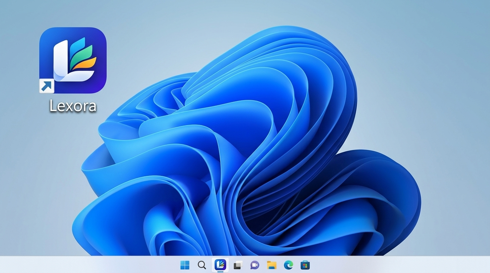
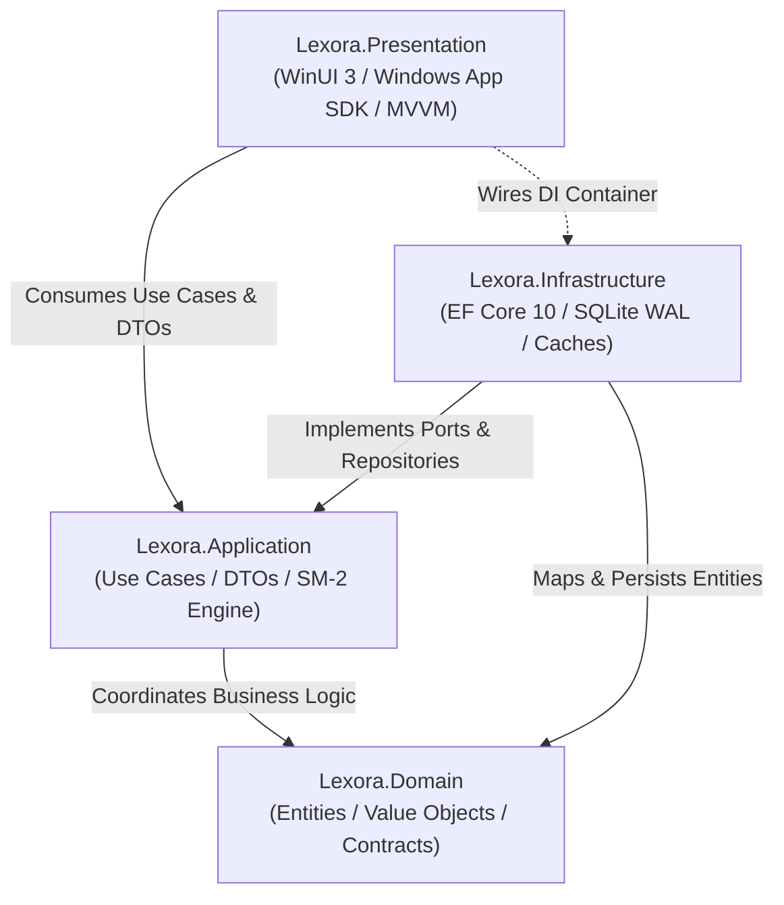

<p align="center">
  
  
</p>

<h1 align="center">Lexora — Intelligent Vocabulary &amp; Grammar Manager</h1>

<p align="center">
  <strong>High-performance, offline-first English learning &amp; spaced repetition desktop application for Windows 11</strong><br>
  <em>Built with C# 13 / .NET 10 • WinUI 3 (Windows App SDK) • Clean Architecture • SQLite WAL &amp; EF Core 10 • Inno Setup 6</em>
</p>

<p align="center">
  
  
  
  
  
  
  
  
  
</p>

<p align="center">
  
</p>

---

## 📖 Table of Contents

- [✨ Overview & Core Capabilities](#-overview--core-capabilities)
- [🏛️ Clean Architecture & System Design](#-clean-architecture--system-design)
- [🧠 Spaced Repetition Algorithm (SM-2)](#-spaced-repetition-algorithm-sm-2)
- [⌨️ Keyboard Shortcuts](#-keyboard-shortcuts)
- [🚀 Quick Start Guide](#-quick-start-guide)
  - [Prerequisites](#prerequisites)
  - [Building & Running All Tests](#building--running-all-tests)
  - [Launching the Application](#launching-the-application)
- [📦 Packaging & Distribution](#-packaging--distribution)
- [📂 Repository Structure](#-repository-structure)
- [📚 Documentation Library](#-documentation-library)
- [📜 Engineering Rules & Guidelines](#-engineering-rules--guidelines)
- [🤝 Contributing & License](#-contributing--license)

---

## ✨ Overview & Core Capabilities

**Lexora** is an enterprise-grade, offline-first personal English learning platform engineered specifically for Windows desktop environments. Combining cognitive science (the Ebbinghaus forgetting curve, Piotr Woźniak's SuperMemo SM-2 algorithm, and FSRS v5) with Windows 11 Fluent Design, Lexora empowers learners to master English vocabulary and grammar with measurable, long-term retention.

### 🌟 Feature Matrix

| Module | Feature | Technical Highlights |
| :--- | :--- | :--- |
| 🧠 **SRS Engine** | **Dual SM-2 & FSRS v5 Repetition** | Mathematically bounded Ease Factor ($EF \ge 1.3$), FSRS 3D memory modeling ($S, D, R$), automatic review queues, and daily streak tracking. |
| 📚 **Vocabulary** | **Rich Multi-Meaning Dictionary** | Comprehensive word entries with CEFR levels (A1–C2), POS categorization, UK/US IPA phonetics, contextual examples, and exam tags (TOEIC, VSTEP, IELTS). |
| 🎙️ **Listening Lab** | **Pronunciation & Listening Lab** | Audio Dictation with Levenshtein scoring, Minimal Pairs phoneme ear-training, articulatory mouth-position guides, and UK vs US accent comparison. |
| 📦 **Learning Storage** | **Targeted Storage Vault** | Specialized repository (`LearningStoragePage`) for targeted vocabulary and grammar items with custom addition reasons and learning statuses. |
| 🔊 **Audio** | **Native Pronunciation Caching** | Offline-cached English audio with automatic local storage fallback, thread-safe background playback, and input path traversal sanitization. |
| 📝 **Practice** | **Interactive 4-Mode Quiz Simulator** | 4 customizable modes: *Word-to-Meaning*, *Meaning-to-Word*, *Fill-in-the-Blank*, and *Multiple Choice* with authentic POS-matched distractors. |
| 💡 **Learning Intelligence** | **Cognitive Memory & At-Risk Analytics** | Ebbinghaus Retrievability modeling ($R = e^{-t/S}$), at-risk vocabulary detector, 7-day cognitive load forecast, and circadian retention analysis. |
| ⚡ **Smart Review** | **High-Yield Adaptive Review Presets** | Instant queue filters for High-Yield items, Stale Memory ($R < 70\%$), Weakest CEFR Tiers, and Cram Sessions with real-time memory stability metrics. |
| 🎯 **Adaptive Testing** | **Computerized Adaptive Testing (CAT)** | Real-time question difficulty recalibration dynamically adjusting to user accuracy, dynamic CEFR scoring, and session crash recovery. |
| 📅 **Study Planner** | **Daily Curriculum & Pacing Manager** | Interactive daily task checklist (new words, reviews, quizzes, grammar), target pacing indicators, streak protection, and offline JSON persistence. |
| 🕸️ **Knowledge Graph** | **Interactive Semantic Vocabulary Network** | Semantic graph traversal across Synonyms, Antonyms, Topics, and CEFR tiers with dynamic node pivoting, instant preview flyout, and native audio. |
| 🩺 **Data Health Center** | **SQLite Diagnostics & Self-Healing** | PRAGMA integrity check, WAL/SHM maintenance, orphan record cleanup, database vacuuming, and pronunciation audio cache management. |
| 📐 **Grammar** | **Structured Grammar Engine** | Structural formula highlighting, in-depth bilingual explanations (Vietnamese & English), and prominent *Common Mistakes* guidance. |
| 📊 **Analytics** | **Dashboard & Activity Heatmap** | GitHub-style 365-day review activity heatmap, streak counters, CEFR level distribution charts, and exam certification readiness meters. |
| 🔄 **Data & Sync** | **Robust Import / Export & Backup** | High-throughput RFC-4180 multiline CSV and JSON exchange, 20MB payload ceiling, and 16-byte header verified database backup/restore. |
| 🚀 **Updates** | **Production Software Updates** | Automatic background check via GitHub Releases API, pre-update SQLite safety snapshots, and Inno Setup silent install handoff. |
| 🎨 **Design** | **Windows 11 Fluent Design** | Modern Mica backdrop, adaptive Light/Dark theme switching, responsive layouts, 250ms debounced search, and zero UI thread stalls. |

---

## 🏛️ Clean Architecture & System Design

Lexora enforces strict architectural boundaries following **Clean Architecture** and **Domain-Driven Design (DDD)**:



### Layer Responsibility Matrix

1. **`Lexora.Domain`** (`net10.0`):
   - Pure domain models: `Word`, `WordMeaning`, `ExampleSentence`, `Topic`, `ExamTag`, `ReviewCard`, `StudySession`, `StudyLog`, `GrammarRule`, `GrammarExample`, `UserStreak`.
   - Domain enums: `PartOfSpeech`, `CefrLevel`, `ExamType`, `LearningStatus`, `ReviewRating`, `TestType`.
   - Zero third-party ORM or UI dependencies.

2. **`Lexora.Application`** (`net10.0`):
   - SuperMemo SM-2 engine (`Sm2SpacedRepetitionEngine`) calculating next review schedules and streak progressions.
   - Application contracts & implementations: `VocabularyService`, `ReviewService`, `StatisticsService`, `GrammarService`, `TestService`, `ExportImportService`.
   - Thread-safe, atomic single-commit business transactions.

3. **`Lexora.Infrastructure`** (`net10.0`):
   - EF Core 10 with SQLite in WAL mode (`LexoraDbContext`).
   - Repository pattern & Unit of Work implementation with entity tracking conflict resolution.
   - Safe audio caching (`LocalAudioStorageService`) with strict path traversal defenses.
   - Database backup/restore engine (`DatabaseBackupService`) with 16-byte SQLite header validation and connection pool flushing.

4. **`Lexora.Presentation`** (`net10.0-windows10.0.26100.0`):
   - Windows App SDK / WinUI 3 desktop application.
   - MVVM powered by `CommunityToolkit.Mvvm` (C# 13 partial properties, command bindings).
   - Responsive layouts (`UniformGridLayout`, adaptive dialogs with top-docked `InfoBar` validation).
   - Dynamic theme switching (`ThemeService`) and runtime bilingual localization (`vi-VN` & `en-US`).

> [!IMPORTANT]
> The Presentation layer (ViewModels and Views) **MUST NEVER** directly execute EF Core queries or reference `LexoraDbContext`. All interactions flow through Application service abstractions.

---

## 🧠 Spaced Repetition Algorithm (SM-2)

Lexora utilizes a mathematically verified implementation of the **SuperMemo SM-2** spaced repetition model:

$$EF' = \max\left(1.3,\; EF + \left(0.1 - (5 - q) \cdot (0.08 + (5 - q) \cdot 0.02)\right)\right)$$

$$Interval(n) = \begin{cases} 1 \text{ day}, & n = 1 \\ 6 \text{ days}, & n = 2 \\ \text{Round}(Interval(n - 1) \cdot EF'), & n > 2 \end{cases}$$

- **Ratings ($q$)**: Mapped to *Again (1)*, *Hard (2)*, *Good (4)*, *Easy (5)*.
- **Ease Factor Floor**: Guaranteed $EF \ge 1.3$ to prevent cards from falling into inescapable review traps ("Ease Hell").
- **Lapse Reset**: Rating a card as *Again* resets repetitions to $0$, schedules the next review for tomorrow ($1$ day), increments lapses, and marks status as `Learning`.
- **Streak Preservation**: Daily active reviews automatically log `StudyLog` entries and update consecutive learning streaks.

---

## ⌨️ Keyboard Shortcuts

| Shortcut | Action | Scope |
| :--- | :--- | :--- |
| <kbd>Ctrl</kbd> + <kbd>1</kbd> | Navigate to **Dashboard** | Global |
| <kbd>Ctrl</kbd> + <kbd>2</kbd> | Navigate to **Vocabulary** | Global |
| <kbd>Ctrl</kbd> + <kbd>3</kbd> | Navigate to **Spaced Review** | Global |
| <kbd>Ctrl</kbd> + <kbd>4</kbd> | Navigate to **Practice & Test** | Global |
| <kbd>Ctrl</kbd> + <kbd>5</kbd> | Navigate to **Grammar** | Global |
| <kbd>Ctrl</kbd> + <kbd>F</kbd> | Focus Global Search Box | Global |
| <kbd>Ctrl</kbd> + <kbd>N</kbd> | Add New Word / Grammar Rule | Vocabulary & Grammar Pages |
| <kbd>Ctrl</kbd> + <kbd>E</kbd> | Edit Selected Word / Rule | Vocabulary & Grammar Pages |
| <kbd>Delete</kbd> | Delete Selected Entry (with confirmation) | Vocabulary & Grammar Pages |
| <kbd>Ctrl</kbd> + <kbd>P</kbd> | Start Grammar Practice Mode | Grammar Page |
| <kbd>Space</kbd> | Flip Flashcard to reveal Answer | Review Session |
| <kbd>1</kbd> / <kbd>2</kbd> / <kbd>3</kbd> / <kbd>4</kbd> | Rate Card (*Again*, *Hard*, *Good*, *Easy*) | Review Session |

---

## 🚀 Quick Start Guide

### Prerequisites

- **OS**: Windows 10 (Version 1809+, Build 17763) or Windows 11 (Recommended).
- **SDK**: [.NET 10 SDK (v10.0+)](https://dotnet.microsoft.com/download/dotnet/10.0).
- **Tooling**: Visual Studio 2026 / Visual Studio 2022 (v17.10+) or VS Code with C# Dev Kit.
- **Installer Compiler** *(Optional)*: [Inno Setup 6](https://jrsoftware.org/isdl.php).

### Building & Running All Tests

```powershell
# 1. Clone repository
git clone https://github.com/Nguyen-Trung-Tien/Lexora.git
cd Lexora

# 2. Build entire solution (must finish with 0 errors and 0 warnings)
dotnet build Lexora.slnx

# 3. Run all unit and integration tests (390 tests)
dotnet test Lexora.slnx
```

### Launching the Application

```powershell
# Launch WinUI 3 desktop application
dotnet run --project src/Lexora.Presentation/Lexora.Presentation.csproj
```

---

## 📦 Packaging & Distribution

Lexora provides an automated build and packaging pipeline using **Inno Setup 6** for generating a standalone, self-contained Windows installer:

```powershell
# Run automated packaging pipeline (Tests -> Self-contained x64 publish -> Inno Setup compilation)
powershell -ExecutionPolicy Bypass -File ./build-installer.ps1 -Version "1.2.2"
```

### Installer Characteristics
- **Output Artifact**: `publish/installer/Lexora-Setup-v1.2.2.exe` (~73 MB).
- **Self-Contained Deployment**: Includes .NET 10 runtime and Windows App SDK binaries; runs out-of-the-box without requiring runtime installations on client machines.
- **User Data Retention**: Upgrading or uninstalling prompts users to preserve their study progress and SQLite database (`%LocalAppData%\Lexora\data\lexora.db`).
- **Silent Deployment**: Supports `/SILENT` and `/VERYSILENT` command-line switches for enterprise rollout.

---

## 📂 Repository Structure

```text
Lexora/
├── assets/                         # Vector & high-res brand identity assets
│   ├── brand/                      # App icons, SVG logos, desktop mockup, brand guide
│   └── vocabularies/               # Seed vocabulary and grammar collections
├── docs/                           # Comprehensive technical documentation library
│   ├── README.md                   # Central documentation portal
│   ├── user_guide.md               # End-user manual & learning guide
│   ├── architecture.md             # Clean Architecture & data flow diagrams
│   ├── api_and_services.md         # Application services & DTO API reference
│   ├── database_schema.md          # SQLite schema, ERD, indexes & cascades
│   ├── spaced_repetition.md        # SM-2 & FSRS v5 mathematical models & worked proofs
│   ├── testing_and_qa.md           # 390-test taxonomy & QA checklists
│   ├── installer_and_distribution.md # Packaging & Inno Setup specification
│   └── contributing.md             # Contribution guide & Git workflow
├── .agents/                        # AI Agent Workspaces, Personas, Rules & Skills
│   ├── hooks.json                  # Lifecycle validation hooks
│   ├── personas/                   # Domain specialized agent personas
│   ├── rules/                      # Modular repository rules & invariants (01-07)
│   └── skills/                     # Standardized, executable agent skills
├── changelog/                      # Keep-a-Changelog unreleased & archive fragments
├── installer/                      # Inno Setup compiler scripts
│   └── LexoraSetup.iss             # Inno Setup 6 configuration script
├── publish/                        # Generated build artifacts & installers
├── src/
│   ├── Lexora.Domain/              # Pure business entities, enums, repository contracts
│   ├── Lexora.Application/         # SM-2 & FSRS v5 engine, service implementations, DTOs
│   ├── Lexora.Infrastructure/      # EF Core 10, SQLite, caching, backup & update engines
│   └── Lexora.Presentation/        # WinUI 3 Fluent UI, MVVM ViewModels, Pages, Dialogs
├── tests/
│   ├── Lexora.Tests.Unit/          # 339 Unit tests (SM-2, FSRS, Listening Lab, CAT, DTOs, Services)
│   └── Lexora.Tests.Integration/   # 51 Integration tests (EF Core SQLite in-memory, Repositories)
├── AGENTS.md                       # Developer & AI Agent development guidelines
├── PROGRESS.md                     # Comprehensive phase completion tracking
├── build-installer.ps1             # Automated packaging & installer script
├── build-release.ps1               # Automated release publish script
└── Lexora.slnx                     # Visual Studio solution file
```

---

## 📚 Documentation Library

Explore our in-depth documentation guides:
- 📖 [**User Guide & Learning Manual**](docs/user_guide.md)
- 🏛️ [**Architecture & System Design**](docs/architecture.md)
- 🔌 [**Application Services & API Reference**](docs/api_and_services.md)
- 🗄️ [**Database Schema & Persistence**](docs/database_schema.md)
- 🧠 [**Spaced Repetition (SM-2) Specifications**](docs/spaced_repetition.md)
- 🧪 [**Testing & Quality Assurance Guide**](docs/testing_and_qa.md)
- 📦 [**Installer & Distribution Guide**](docs/installer_and_distribution.md)
- 🤝 [**Contributing Guidelines**](docs/contributing.md)

---

## 📜 Engineering Rules & Guidelines

All contributors and autonomous agents must follow the repository invariants:
- 🏛️ [**Rule 01: Clean Architecture & Boundaries**](.agents/rules/01-clean-architecture.md)
- 💻 [**Rule 02: C# 13 & .NET 10 Coding Standards**](.agents/rules/02-csharp-dotnet-standards.md)
- 🎨 [**Rule 03: WinUI 3 & Fluent UI/UX Guidelines**](.agents/rules/03-winui3-fluent-design.md)
- 🔒 [**Rule 04: Security & Data Protection Invariants**](.agents/rules/04-security-and-data-protection.md)
- 🧠 [**Rule 05: Spaced Repetition (SM-2) Integrity**](.agents/rules/05-spaced-repetition-sm2.md)
- 🧪 [**Rule 06: Testing & Quality Gate Protocols**](.agents/rules/06-testing-and-verification.md)
- ⚡ [**Rule 07: AI Agent Token Optimization & Precision**](.agents/rules/07-agent-token-efficiency-and-accuracy.md)

---

## 🤝 Contributing & License

Contributions are welcome! Please read [CONTRIBUTING.md](docs/contributing.md) and submit pull requests to our GitHub repository.

Developed by **Lexora Team**. Distributed under the [MIT License](https://opensource.org/licenses/MIT).
