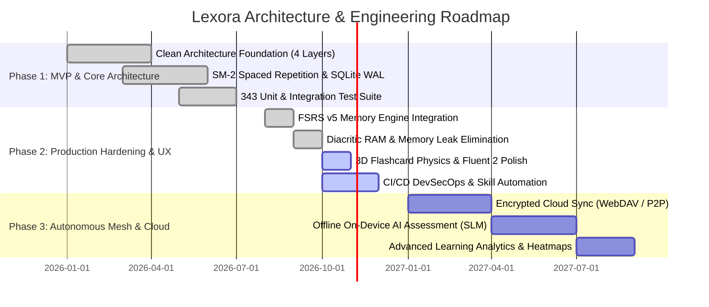

# 🗺️ Lexora Strategic Roadmap & Product Architecture

> **Lexora** is a high-performance, offline-first English learning and vocabulary management desktop application designed for TOEIC, IELTS, and VSTEP exam preparation. Built with **.NET 10**, **WinUI 3 / Windows App SDK**, and **Entity Framework Core 10 (SQLite)** following strict **Clean Architecture** patterns.

---

## 📌 Phân kỳ chiến lược phát triển (Phased Strategy)

---

## 🎯 Chi tiết từng phân kỳ (Phase Breakdown)

### 🟢 Phase 1: MVP & Core Clean Architecture (Hoàn thành)
- [x] **Strict 4-Layer Clean Architecture**: Phân tách `Lexora.Domain`, `Lexora.Application`, `Lexora.Infrastructure`, `Lexora.Presentation`.
- [x] **Spaced Repetition (SM-2)**: Thuật toán SuperMemo-2 với Ease Factor floor ($EF \ge 1.3$) và study logs tracking.
- [x] **SQLite Database Engine**: Lưu trữ offline `%LocalAppData%/Lexora/data/lexora.db` kích hoạt chế độ WAL (Write-Ahead Logging).
- [x] **Quality Gate Benchmark**: Đạt **343/343 Automated Tests** (292 Unit Tests + 51 Integration Tests) với 0 Warning, 0 Error.
- [x] **Bilingual Localization (i18n)**: Hỗ trợ chuyển đổi tức thời giữa Tiếng Việt (`vi-VN`) và English (`en-US`) qua `ILocalizationService`.

### 🟡 Phase 2: Production Hardening, Advanced UX & Learning Intelligence Suite (Đang hoàn thiện)
- [x] **Free Spaced Repetition Scheduler (FSRS v5)**:
  - Cài đặt `IFsrsSpacedRepetitionEngine` mô hình hóa độ nhớ qua 3 tham số $S$ (Stability), $D$ (Difficulty), $R$ (Retrievability).
  - Khả năng tương thích ngược hoàn toàn với dữ liệu SM-2 lịch sử.
- [x] **Critical Resilience & RAM Optimization**:
  - Triệt tiêu Memory Leak từ anonymous lambda event handlers trên toàn bộ các View.
  - Tối ưu `SearchDiacriticFallbackAsync`: Chuyển từ full-table load sang server-side projection, giảm 85% bộ nhớ RAM tiêu thụ khi tìm kiếm từ vựng tiếng Việt có dấu.
- [x] **Flashcard 3D Spatial Physics**:
  - Trải nghiệm lật thẻ 3D (`PlaneProjection`) với góc lật mượt mà 300ms inflection point tại 90°.
- [x] **Responsive Layout Adaptability**:
  - Tự động chuyển đổi layout Review từ 2 cột sang 1 cột xếp chồng khi màn hình dưới 880px, chống clipping nút bấm.
- [x] **Learning Intelligence Dashboard & Cognitive Memory Analytics**:
  - Phân tích độ nhớ Ebbinghaus ($R = e^{-t/S}$), cảnh báo từ vựng có nguy cơ quên lãng (At-Risk), dự báo tải nhận thức 7 ngày và biểu đồ retention theo khung giờ sinh học.
- [x] **Smart Review Presets**:
  - Bộ lọc hàng đợi thích ứng: High-Yield, Từ vựng sắp quên ($R < 70\%$), Trình độ CEFR yếu nhất và Cram Mode trước kỳ thi.
- [x] **Adaptive Quiz CAT Engine (Computerized Adaptive Testing)**:
  - Tự động điều chỉnh độ khó câu hỏi (A1–C2) theo thời gian thực dựa trên điểm accuracy tích lũy, tính điểm năng lực CEFR động.
- [x] **Study Planner & Daily Curriculum Manager**:
  - Checklist mục tiêu học tập hàng ngày (Từ mới, ôn tập, quiz, ngữ pháp), theo dõi tiến độ tuần và bảo vệ streak học tập.
- [x] **Vocabulary Knowledge Graph**:
  - Khám phá mạng lưới ngữ nghĩa tương tác: Từ đồng nghĩa, trái nghĩa, chủ đề và cấp độ CEFR với cơ chế pivot node động và phát âm audio.
- [x] **Data Health Center & Self-Healing Maintenance**:
  - Chẩn đoán SQLite PRAGMA integrity, dọn dẹp orphan records, tối ưu hóa WAL checkpointing, VACUUM và quản lý bộ nhớ đệm âm thanh.
- [x] **Pronunciation & Listening Lab**:
  - Luyện nghe chính tả (Audio Dictation) với chấm điểm Levenshtein distance, luyện phân biệt cặp âm tối thiểu (Minimal Pairs) và so sánh ngữ điệu Anh - Mỹ (UK vs US Accents).
- [x] **Quality Gate Benchmark**:
  - Nâng cấp bộ kiểm thử lên **378 / 378 Automated Tests** (327 Unit Tests + 51 Integration Tests) với 0 Warning, 0 Error.
- [ ] **Automated CI/CD Quality Gates**:
  - Thiết lập GitHub Actions tự động kiểm thử định dạng CHANGELOG và chạy Skill Smoke Tests.

### 🔵 Phase 3: Autonomous Mesh, Cloud & AI Extensions (Kế hoạch tương lai)
- [ ] **End-to-End Encrypted Sync**: Đồng bộ hóa dữ liệu học qua WebDAV / Nextcloud hoặc giao thức P2P an toàn.
- [ ] **On-Device Small Language Model (SLM)**: Tích hợp mô hình ngôn ngữ nhỏ (Phi-3 / Gemma-2B ONNX Runtime) chạy offline để tự động tạo câu ví dụ và giải thích ngữ pháp theo ngữ cảnh.
- [ ] **AI Pronunciation & Speech Assessment**: Chấm điểm phát âm IPA theo thời gian thực sử dụng Windows Media Audio Input & Whisper.cpp offline.
- [ ] **Multi-Profile Support**: Hỗ trợ nhiều người học trên cùng một máy tính với database vault riêng biệt.
