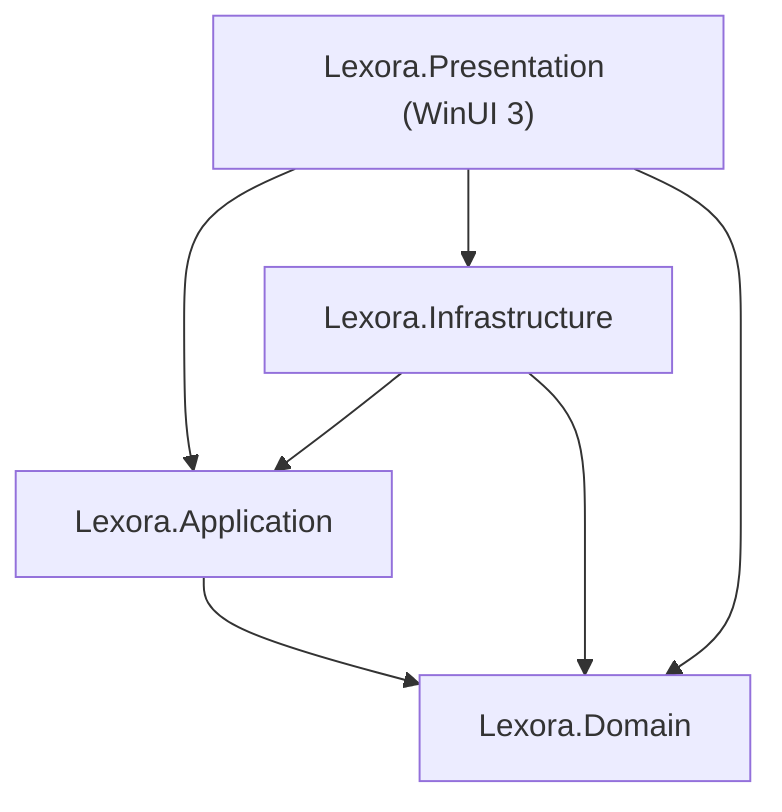

# ADR-0001: Adoption of 4-Layer Clean Architecture on .NET 10 & WinUI 3

- **Status**: Accepted
- **Date**: 2026-01-15
- **Authors**: Architectural Board
- **Deciders**: Lexora Core Team

## Context & Problem Statement
Lexora requires a desktop architecture that isolates core vocabulary learning business logic (SM-2 / FSRS, CEFR levels, grammar rules) from user interface technologies (WinUI 3 / Windows App SDK) and data storage mechanisms (EF Core 10 / SQLite). Direct coupling would impede automated testing and render porting or upgrading painful.

## Decision Drivers
- Testability: Domain and Application logic must be testable without launching WinUI 3 host processes or requiring UI mocks.
- Purity: Core business logic must remain independent of external libraries or frameworks.
- Separation of Concerns: Presentation views and ViewModels must not access DbContext or execute raw queries.

## Considered Options
1. Traditional 2-Tier WinUI 3 App (Code-behind + Direct EF Core queries).
2. 3-Tier Layered Architecture (Presentation -> Business Logic -> Data Access).
3. 4-Layer Clean Architecture (`Domain`, `Application`, `Infrastructure`, `Presentation`).

## Decision Outcome
Chosen option: **4-Layer Clean Architecture**.

### Layer Hierarchy

### Positive Consequences
- `Lexora.Domain` has zero third-party dependencies, guaranteeing stability and high execution speed in unit tests.
- 100% of application logic can be validated via unit tests in headless environments.
- Clear team boundaries and rule enforcement via `.agents/rules/01-clean-architecture.md`.

### Negative Consequences / Trade-offs
- Requires boilerplate mapping between Domain entities and Application DTOs.
- Stricter code reviews to prevent boundary leakage.
