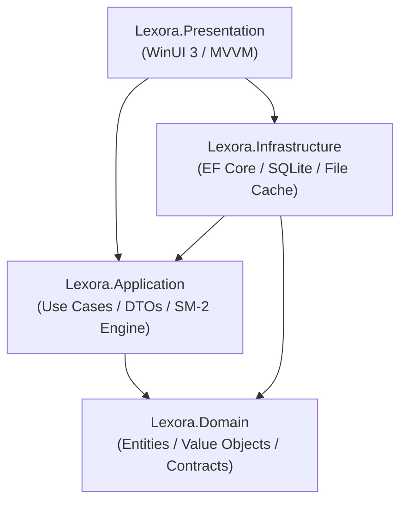

# Lexora Architecture Documentation

## 1. Architectural Philosophy

Lexora is designed around **Clean Architecture** (Robert C. Martin) and **Domain-Driven Design (DDD)** principles to provide maximum maintainability, testability, and decoupling between business logic, database persistence, and desktop UI presentation.



---

## 2. Projects and Responsibilities

### `Lexora.Domain`
- Contains enterprise business rules, core entities, domain enums, and repository abstraction contracts.
- Independent of external frameworks, libraries, UI, and database technology.

### `Lexora.Application`
- Contains application business logic, service interfaces, DTOs, and the SM-2 Spaced Repetition calculation engine.
- Implements use cases: vocabulary search/management, review queue management, statistics aggregation, grammar rules lookup.

### `Lexora.Infrastructure`
- Implements data access using Entity Framework Core with SQLite.
- Manages relational mapping, indexes, and database lifecycle (`SqliteDatabaseInitializer`).
- Implements `IVocabularyRepository`, `IReviewRepository`, `IGrammarRepository`, and `IUnitOfWork`.
- Provides file and system storage services: `LocalAudioStorageService` and `DatabaseBackupService`.

### `Lexora.Presentation`
- WinUI 3 desktop application using the Windows App SDK.
- MVVM pattern via `CommunityToolkit.Mvvm`.
- Fluent design system with Mica material backdrop, NavigationView shell, and responsive master-detail layouts.
- Dynamic theme switching (`Light`, `Dark`, `System`) and multi-language localization (`vi-VN`, `en-US`).

---

## 3. Dependency Injection Setup

All dependencies are wired in `App.xaml.cs` using `Microsoft.Extensions.Hosting`:

```csharp
services.AddApplication();
services.AddInfrastructure();

// Presentation singletons
services.AddSingleton<INavigationService, NavigationService>();
services.AddSingleton<IThemeService, ThemeService>();
services.AddSingleton<ILocalizationService, LocalizationService>();

// ViewModels
services.AddTransient<ShellViewModel>();
services.AddTransient<DashboardViewModel>();
services.AddTransient<VocabularyViewModel>();
services.AddTransient<ReviewViewModel>();
services.AddTransient<GrammarViewModel>();
services.AddTransient<SettingsViewModel>();
```
