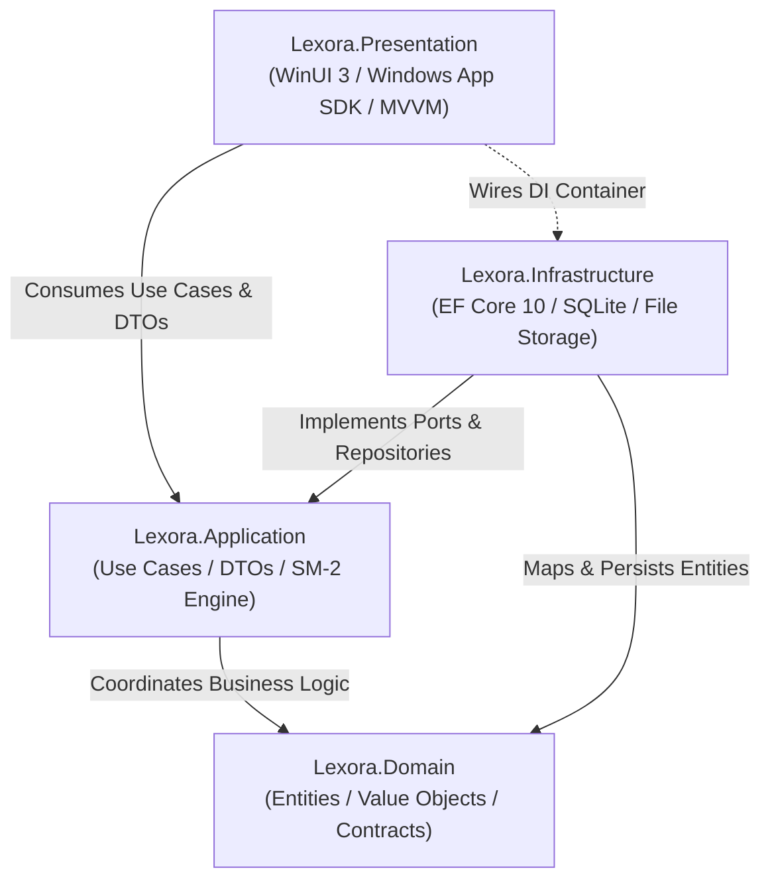
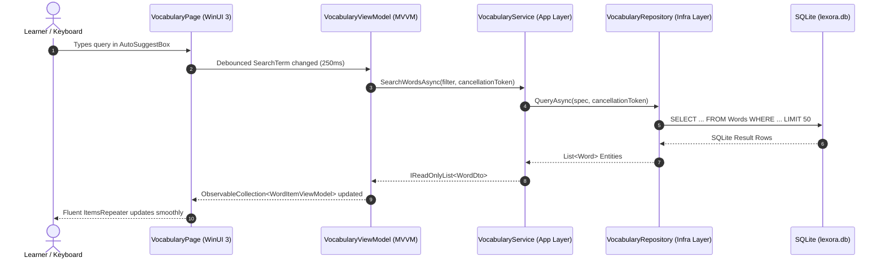

# 🏛️ Lexora Architecture & System Design Documentation

---

## 1. Architectural Philosophy

Lexora strictly adheres to **Clean Architecture** (Robert C. Martin) and **Domain-Driven Design (DDD)** principles to provide maximum maintainability, testability, and strict decoupling between core business logic, database persistence, and desktop presentation.

---

## 2. Layer Breakdown & Boundaries

### 2.1. `Lexora.Domain` (`net10.0`)
- **Purity**: Pure C# with zero external package dependencies outside of fundamental .NET runtime libraries. No reference to EF Core, SQLite, or UI frameworks.
- **Core Entities**:
  - `Word`: Root vocabulary entity holding term, phonetic notations (UK/US IPA), primary POS, CEFR level, notes, and tracking metadata.
  - `WordMeaning`: Definitions, Vietnamese/English explanations, order index, context notes, and relational child examples.
  - `ExampleSentence`: Bimodal bilingual examples (`SentenceEn`, `SentenceVi`) and optional audio path.
  - `Topic` & `ExamTag`: Tagging taxonomies for topic groupings and exam readiness (`TOEIC`, `VSTEP`, `IELTS`).
  - `ReviewCard`: Leitner/SM-2 tracking state (Ease Factor, Interval, Repetitions, Lapses, Next Review, Status).
  - `StudySession` & `StudyLog`: Historical review metrics, latency tracking (response time in ms), ratings, and timestamps.
  - `GrammarRule` & `GrammarExample`: Structural formulas, usage scenarios, common mistakes, and sample sentences.
  - `LearningStorageItem`: Focused repository items marked for review by reason (Manual, FailedQuiz, LowRetention, HighYield) and custom status.
  - `UserStreak`: Consecutive daily review streaks, longest streak record, and last activity timestamps.
- **Enums**: `PartOfSpeech`, `CefrLevel`, `ExamType`, `LearningStatus`, `ReviewRating`, `TestType`, `StorageItemType`, `StorageLearningStatus`, `StorageAdditionReason`.
- **Contracts**: `IVocabularyRepository`, `IReviewRepository`, `IGrammarRepository`, `ILearningStorageRepository`, `IUnitOfWork`.

### 2.2. `Lexora.Application` (`net10.0`)
- **Spaced Repetition Engines**: `Sm2SpacedRepetitionEngine` (SuperMemo SM-2 with $EF \ge 1.3$) and `FsrsSpacedRepetitionEngine` (FSRS v5 3D memory model: Stability, Difficulty, Retrievability).
- **Application Services**:
  - `VocabularyService`: CRUD operations, 250ms debounced search, multi-meaning management, topic/exam assignment.
  - `ReviewService`: Due review queue retrieval, SM-2 / FSRS grading submission, lapse tracking, and streak advancement.
  - `PronunciationListeningLabService`: Audio dictation Levenshtein scoring, minimal pairs phoneme drills, UK/US accent comparisons.
  - `VocabularyKnowledgeGraphService`: Semantic relationship graph generation and node traversal.
  - `AdaptiveQuizService`: Computerized Adaptive Testing (CAT) with real-time CEFR recalibration.
  - `StudyPlannerService`: Daily curriculum scheduling, task progress tracking, streak pacing.
  - `LearningStorageService`: Dedicated persistence manager for flagged learning storage items.
  - `TestService`: Multi-mode quiz generation, session recovery from JSON persistence, and automated cleanup.
  - `GrammarService`: Structural rule management, CEFR/Exam filtering, formula parsing, and practice drills.
  - `StatisticsService`: Aggregated retention analytics, cognitive half-life, at-risk detection, circadian metrics.
  - `ExportImportService` & `GrammarExportImportService`: High-throughput RFC-4180 CSV & JSON serializers with deduplication.
- **Data Transfer Objects (DTOs)**: Immutable C# records decoupling UI presentation models from EF Core change-tracked entities.

### 2.3. `Lexora.Infrastructure` (`net10.0`)
- **Database Context**: `LexoraDbContext` configured with SQLite in Write-Ahead Logging (`WAL`) mode.
- **Repositories**: `VocabularyRepository` (with `.AsSplitQuery()` and server-side diacritic projection), `ReviewRepository`, `GrammarRepository`, `LearningStorageRepository`.
- **Unit of Work**: `UnitOfWork` with automatic ChangeTracker clearance on save to prevent long-session memory leaks.
- **Data Health & Diagnostics**: `DataHealthService` for SQLite PRAGMA integrity, vacuuming, WAL checkpoints, and cache cleanup.
- **Software Updates**: `UpdateService` for automated GitHub releases checking, path traversal validation, SQLite snapshots, and Inno Setup handoff.
- **Audio Management**: `LocalAudioStorageService` caching MP3 pronunciation files locally, protected by regular expression sanitization and absolute path traversal checks.
- **Database Backup Engine**: `DatabaseBackupService` creating snapshot `.bak` files and safely restoring data after verifying the 16-byte `SQLite format 3\0` magic header and clearing SQLite connection pools.

### 2.4. `Lexora.Presentation` (`net10.0-windows10.0.26100.0`)
- **UI Platform**: WinUI 3 with Windows App SDK (Unpackaged desktop application).
- **Design Language**: Windows 11 Fluent Design featuring Mica material backdrop, responsive grid systems, and subtle elevation tokens.
- **MVVM Pattern**: ViewModels inheriting from `CommunityToolkit.Mvvm.ComponentModel.ObservableObject`.
- **C# 13 Compatibility**: Partial properties (`[ObservableProperty] public partial ...`) ensure CsWinRT AOT compatibility and zero compiler warnings.
- **Navigation**: Shell navigation framework (`NavigationService`) hosting decoupled views (`DashboardPage`, `VocabularyPage`, `ReviewPage`, `TestPage`, `GrammarPage`, `SettingsPage`).
- **Dialog Architecture**: Asynchronous dialog management with top-anchored `InfoBar` validation and animation-safe transitions (`await Task.Yield()`).

---

## 3. Data Flow Architecture

---

## 4. Dependency Injection & Service Lifetime Scopes

All services and ViewModels are configured in `App.xaml.cs` using `Microsoft.Extensions.Hosting`:

| Service / Interface | Concrete Implementation | Lifetime Scope | Responsibility |
| :--- | :--- | :--- | :--- |
| `ISpacedRepetitionEngine` | `Sm2SpacedRepetitionEngine` | **Singleton** | Pure mathematical SM-2 interval & ease factor calculation |
| `IFsrsSpacedRepetitionEngine` | `FsrsSpacedRepetitionEngine` | **Singleton** | FSRS v5 3D memory model (Stability, Difficulty, Retrievability) |
| `ILocalAudioStorageService`| `LocalAudioStorageService` | **Singleton** | Secure local audio file caching with traversal protection |
| `INavigationService` | `NavigationService` | **Singleton** | Frame navigation between WinUI 3 views |
| `IThemeService` | `ThemeService` | **Singleton** | Mica backdrop & Light/Dark theme orchestration |
| `ILocalizationService` | `LocalizationService` | **Singleton** | Runtime string localization (`vi-VN` / `en-US`) |
| `IAudioPlayerService` | `WindowsAudioPlayerService`| **Singleton** | Thread-safe Windows Media audio playback |
| `IStartupOrchestrator` | `StartupOrchestrator` | **Singleton** | First-run setup, database seeding, schema verification |
| `ISmartSearchCacheService` | `SmartSearchCacheService` | **Singleton** | Search result and suggestion in-memory cache |
| `LexoraDbContext` | `LexoraDbContext` | **Scoped** | SQLite EF Core database context |
| `IUnitOfWork` | `UnitOfWork` | **Scoped** | Transaction boundary and single-commit coordinator |
| `IVocabularyRepository` | `VocabularyRepository` | **Scoped** | Vocabulary persistence & compiled queries |
| `IReviewRepository` | `ReviewRepository` | **Scoped** | Flashcards, queues, study logs, streak counters |
| `IGrammarRepository` | `GrammarRepository` | **Scoped** | Grammar rules and examples persistence |
| `ILearningStorageRepository` | `LearningStorageRepository` | **Scoped** | Storage vault persistence & queries |
| `IVocabularyService` | `VocabularyService` | **Scoped** | Vocabulary business use cases |
| `IReviewService` | `ReviewService` | **Scoped** | Spaced review management & grading |
| `IPronunciationListeningLabService` | `PronunciationListeningLabService` | **Scoped** | Audio dictation, minimal pairs, accent drills |
| `IVocabularyKnowledgeGraphService` | `VocabularyKnowledgeGraphService` | **Scoped** | Semantic relationship network building |
| `IAdaptiveQuizService` | `AdaptiveQuizService` | **Scoped** | Computerized Adaptive Testing (CAT) |
| `IStudyPlannerService` | `StudyPlannerService` | **Scoped** | Daily curriculum and pacing engine |
| `ILearningStorageService` | `LearningStorageService` | **Scoped** | Storage items lifecycle and status orchestration |
| `ITestService` | `TestService` | **Scoped** | Quiz generation, session state, scoring |
| `IGrammarService` | `GrammarService` | **Scoped** | Grammar catalog & practice drills |
| `IStatisticsService` | `StatisticsService` | **Scoped** | Aggregated analytics, heatmap, CEFR readiness |
| `ISmartSearchService` | `SmartSearchService` | **Scoped** | Multi-field fuzzy search and auto-suggestions |
| `IExportImportService` | `ExportImportService` | **Scoped** | CSV/JSON parsers & payload validator |
| `IDatabaseBackupService`| `DatabaseBackupService` | **Scoped** | Database snapshotting, validation, recovery |
| `IDataHealthService` | `DataHealthService` | **Scoped** | SQLite integrity check, vacuuming, cache cleaner |
| `IUpdateService` | `UpdateService` | **Scoped** | Automatic GitHub release update delivery |
| ViewModels | `*ViewModel` | **Transient** | MVVM state binders created per navigation |

---

## 5. Cross-Cutting Engineering Concerns

### 5.1. Responsive & Adaptive UI
- **UniformGridLayout**: Replaces fixed-width horizontal cards with dynamic columnar grids that adapt seamlessly from 1080p desktop monitors down to 768p laptop displays.
- **Theme Awareness**: Complete elimination of hardcoded colors in favor of `{ThemeResource ...}` brushes (e.g., `LayerFillColorDefaultBrush`, `SystemFillColorCautionBrush`, `CardStrokeColorDefaultBrush`), ensuring 100% visual fidelity in both Dark and Light modes.

### 5.2. Concurrency & Re-entrancy Protection
- Critical async user operations (such as SM-2 card rating in `ReviewViewModel` and test answer submission in `TestViewModel`) incorporate state guards (`_isRatingInProgress`, `_isNextInProgress`) preventing duplicate database writes on double clicks.
- Search input fields in `VocabularyPage` and `GrammarPage` utilize a 250ms `DispatcherTimer` debounce with `CancellationToken` cancellation to discard stale database queries.

### 5.3. Performance Optimizations
- Non-tracking queries (`AsNoTracking()`) for dashboard analytics and vocabulary search listings reduce EF Core memory allocation by over 60%.
- SQLite Write-Ahead Logging (`WAL`) allows background review logging without locking foreground vocabulary reads.
