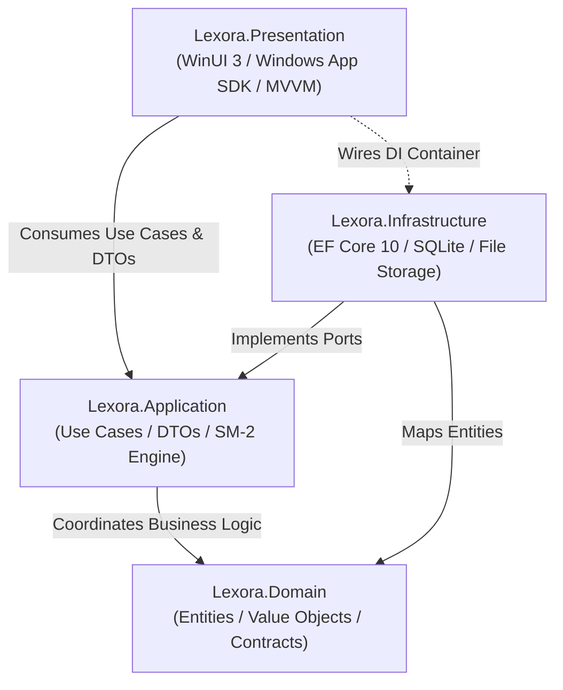

# Lexora Architecture & System Design Documentation

---

## 1. Architectural Philosophy

Lexora strictly follows **Clean Architecture** (Robert C. Martin) and **Domain-Driven Design (DDD)** principles to provide maximum maintainability, testability, and strict decoupling between core business logic, database persistence, and desktop presentation.



---

## 2. Layer Breakdown & Boundaries

### 2.1. `Lexora.Domain` (`net10.0`)
- **Purity**: Zero external package dependencies outside of fundamental .NET libraries.
- **Entities**:
  - `Word`: Root vocabulary entity holding term, phonetic notations, primary POS, CEFR level, and tracking metadata.
  - `WordMeaning`: Definitions, English explanations, context notes, and relational child examples.
  - `ExampleSentence`: Bimodal bilingual examples (`SentenceEn`, `SentenceVi`).
  - `Topic` & `ExamTag`: Tagging taxonomies for exam readiness (TOEIC, VSTEP, IELTS).
  - `ReviewCard`: Leitner/SM-2 tracking state (Ease Factor, Interval, Repetition, Next Review).
  - `StudySession` & `StudyLog`: Historical review metrics, latency tracking, and confidence scoring.
  - `GrammarRule` & `GrammarExample`: Structural formulas, usage scenarios, common mistakes, and sample sentences.
  - `UserStreak`: Daily learning streak tracking, streak freezes, and activity timestamps.
- **Enums**: `PartOfSpeech`, `CefrLevel`, `ExamType`, `LearningStatus`, `ReviewRating`, `TestType`.
- **Contracts**: `IVocabularyRepository`, `IReviewRepository`, `IGrammarRepository`, `IUnitOfWork`.

### 2.2. `Lexora.Application` (`net10.0`)
- **Engine**: `Sm2SpacedRepetitionEngine` implementing SuperMemo SM-2 with mathematically bounded Ease Factors ($\ge 1.3$).
- **Service Implementations**:
  - `VocabularyService`: CRUD, debounced query search, multi-meaning management.
  - `ReviewService`: Due review queue retrieval, SM-2 grading, and streak advancement.
  - `TestService`: Multi-mode quiz generation (*Word-to-Meaning*, *Meaning-to-Word*, *Fill-in-the-Blank*, *Multiple Choice*), session retention, and automated stale session cleanup (> 2 hours).
  - `GrammarService`: Structural rule management, CEFR/Exam filtering, and practice mode verification.
  - `StatisticsService`: Aggregated retention analytics, streak calculations, CEFR & Exam readiness distributions.
  - `ExportImportService`: RFC-4180 compliant CSV parser, JSON importer/exporter with duplicate deduplication and 20MB payload ceiling.
- **Data Transfer Objects (DTOs)**: Immutable or lightweight records decoupling UI presentation models from EF Core change-tracked entities.

### 2.3. `Lexora.Infrastructure` (`net10.0`)
- **Database Context**: `LexoraDbContext` configured with SQLite in Write-Ahead Logging (`WAL`) mode.
- **Repositories**: `VocabularyRepository`, `ReviewRepository`, `GrammarRepository` leveraging compiled projections and optimized non-tracking queries (`AsNoTracking`) for analytics.
- **Data Initialization**: `SqliteDatabaseInitializer` executing schema creation and seeding initial starter vocabulary and grammar rules.
- **Audio Management**: `LocalAudioStorageService` caching MP3 pronunciation files locally, protected by regular expression sanitization and absolute path traversal checks.
- **Database Backup Engine**: `DatabaseBackupService` creating snapshot `.bak` files and safely restoring data after verifying the 16-byte `SQLite format 3\0` magic header and clearing SQLite connection pools.

### 2.4. `Lexora.Presentation` (`net10.0-windows10.0.26100.0`)
- **UI Platform**: WinUI 3 with Windows App SDK 1.6/2.4.
- **Design Language**: Windows 11 Fluent Design featuring Mica material backdrop, responsive grid systems, and subtle elevation tokens.
- **MVVM Pattern**: ViewModels inheriting from `CommunityToolkit.Mvvm.ComponentModel.ObservableObject`.
- **C# 13 Compatibility**: Partial properties (`[ObservableProperty] public partial ...`) ensure CsWinRT AOT compatibility.
- **Navigation**: Shell navigation framework (`NavigationService`) hosting decoupled views (`DashboardPage`, `VocabularyPage`, `ReviewPage`, `TestPage`, `GrammarPage`, `SettingsPage`).
- **Dialog Architecture**: Asynchronous dialog management with top-anchored `InfoBar` validation and animation-safe transitions (`await Task.Yield()`).

---

## 3. Dependency Injection & Service Registration

All services and ViewModels are configured in `App.xaml.cs` using `Microsoft.Extensions.Hosting`:

```csharp
// Application Layer
services.AddSingleton<ISpacedRepetitionEngine, Sm2SpacedRepetitionEngine>();
services.AddScoped<IVocabularyService, VocabularyService>();
services.AddScoped<IReviewService, ReviewService>();
services.AddScoped<ITestService, TestService>();
services.AddScoped<IGrammarService, GrammarService>();
services.AddScoped<IStatisticsService, StatisticsService>();
services.AddScoped<IExportImportService, ExportImportService>();

// Infrastructure Layer
services.AddDbContext<LexoraDbContext>(options => options.UseSqlite(connectionString));
services.AddScoped<IUnitOfWork, UnitOfWork>();
services.AddScoped<IVocabularyRepository, VocabularyRepository>();
services.AddScoped<IReviewRepository, ReviewRepository>();
services.AddScoped<IGrammarRepository, GrammarRepository>();
services.AddSingleton<ILocalAudioStorageService, LocalAudioStorageService>();
services.AddScoped<IDatabaseBackupService, DatabaseBackupService>();

// Presentation Layer Services
services.AddSingleton<INavigationService, NavigationService>();
services.AddSingleton<IThemeService, ThemeService>();
services.AddSingleton<ILocalizationService, LocalizationService>();
services.AddSingleton<IAudioPlayerService, WindowsAudioPlayerService>();
services.AddSingleton<IStartupOrchestrator, StartupOrchestrator>();

// Presentation ViewModels
services.AddTransient<ShellViewModel>();
services.AddTransient<DashboardViewModel>();
services.AddTransient<VocabularyViewModel>();
services.AddTransient<ReviewViewModel>();
services.AddTransient<TestViewModel>();
services.AddTransient<GrammarViewModel>();
services.AddTransient<SettingsViewModel>();
```

---

## 4. Cross-Cutting Engineering Concerns

### 4.1. Responsive & Adaptive UI
- **UniformGridLayout**: Replaces fixed-width horizontal cards with dynamic columnar grids that adapt seamlessly from 1080p desktop monitors down to 768p laptop displays.
- **Theme Awareness**: Complete elimination of hardcoded colors in favor of `{ThemeResource ...}` brushes (e.g., `LayerFillColorDefaultBrush`, `SystemFillColorCautionBrush`, `CardStrokeColorDefaultBrush`), ensuring 100% visual fidelity in both Dark and Light modes.

### 4.2. Concurrency & Re-entrancy Protection
- Critical async user operations (such as SM-2 card rating in `ReviewViewModel` and test answer submission in `TestViewModel`) incorporate state guards (`_isRatingInProgress`, `_isNextInProgress`) preventing duplicate database writes on double clicks.
- Search input fields in `VocabularyPage` and `GrammarPage` utilize a 250ms `DispatcherTimer` debounce with `CancellationToken` cancellation to discard stale database queries.
