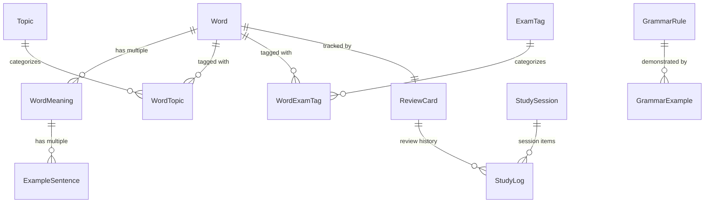

# Lexora Database Schema Documentation

## 1. Overview

Lexora utilizes an offline-first **SQLite** database via **Entity Framework Core**.
Default file location: `%LocalAppData%\Lexora\data\lexora.db`.

---

## 2. Entity Relationship Diagram

---

## 3. Tables Specification

### `Words`

- `Id` (Guid, PK)
- `Term` (NVARCHAR(150), Indexed)
- `NormalizedTerm` (NVARCHAR(150), Indexed)
- `PhoneticUk` (NVARCHAR)
- `PhoneticUs` (NVARCHAR)
- `AudioUkPath` (NVARCHAR)
- `AudioUsPath` (NVARCHAR)
- `Level` (INTEGER, Indexed, CefrLevel enum)
- `PrimaryPartOfSpeech` (INTEGER, Indexed, PartOfSpeech enum)
- `Notes` (NVARCHAR)
- `CreatedAt` (DATETIME)
- `UpdatedAt` (DATETIME)

### `WordMeanings`

- `Id` (Guid, PK)
- `WordId` (Guid, FK -> Words.Id, Cascade Delete)
- `PartOfSpeech` (INTEGER, PartOfSpeech enum)
- `DefinitionVi` (NVARCHAR(500))
- `DefinitionEn` (NVARCHAR)
- `Explanation` (NVARCHAR)
- `OrderIndex` (INTEGER)

### `ExampleSentences`

- `Id` (Guid, PK)
- `WordMeaningId` (Guid, FK -> WordMeanings.Id, Cascade Delete)
- `SentenceEn` (NVARCHAR(1000))
- `SentenceVi` (NVARCHAR(1000))
- `AudioPath` (NVARCHAR)

### `ReviewCards`

- `Id` (Guid, PK)
- `WordId` (Guid, FK -> Words.Id, Unique, Cascade Delete)
- `Status` (INTEGER, Indexed, LearningStatus enum)
- `EaseFactor` (REAL, default 2.5)
- `IntervalDays` (INTEGER, default 0)
- `Repetitions` (INTEGER, default 0)
- `Lapses` (INTEGER, default 0)
- `LastReviewedAt` (DATETIME, Nullable)
- `NextReviewAt` (DATETIME, Indexed)
- `TotalReviews` (INTEGER)
- `CorrectReviews` (INTEGER)

### `StudyLogs`

- `Id` (Guid, PK)
- `ReviewCardId` (Guid, FK -> ReviewCards.Id, Cascade Delete)
- `StudySessionId` (Guid, FK -> StudySessions.Id, Nullable, Cascade Delete)
- `Rating` (INTEGER, ReviewRating enum)
- `ResponseTimeMs` (INTEGER)
- `ResultingStatus` (INTEGER)
- `ResultingIntervalDays` (INTEGER)
- `CreatedAt` (DATETIME, Indexed)

### `GrammarRules` & `GrammarExamples`

- `Id` (Guid, PK)
- `Title` (NVARCHAR(200))
- `Structure` (NVARCHAR(500))
- `ExplanationVi` (NVARCHAR)
- `ExplanationEn` (NVARCHAR)
- `CommonMistakes` (NVARCHAR)
- `Level` (INTEGER, CefrLevel enum)
- `ExamTarget` (INTEGER, ExamType enum)
- `Topic` (NVARCHAR)

### `UserStreaks`

- `Id` (Guid, PK)
- `CurrentStreak` (INTEGER)
- `LongestStreak` (INTEGER)
- `LastActiveDate` (DATE)
- `TotalDaysLearned` (INTEGER)
