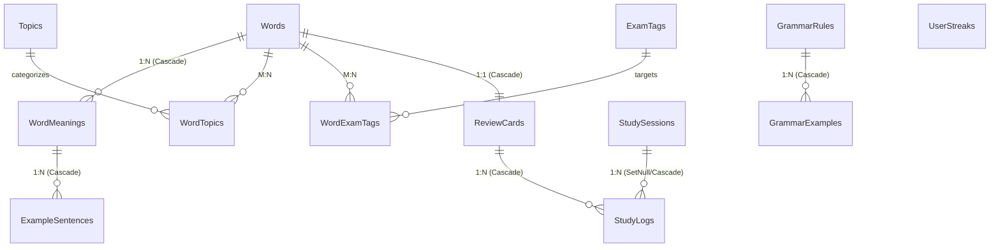

# Lexora Database Schema & Persistence Documentation

---

## 1. Overview & Engine Configuration

Lexora uses **SQLite** managed via **Entity Framework Core 10**.

- **Default Location**: `%LocalAppData%\Lexora\data\lexora.db`
- **Journal Mode**: Write-Ahead Logging (`PRAGMA journal_mode=WAL;`), enabling simultaneous reads while writing.
- **Foreign Key Constraints**: Enabled (`PRAGMA foreign_keys=ON;`).
- **Synchronous Mode**: Normal (`PRAGMA synchronous=NORMAL;`), balancing durability with high disk I/O performance.

---

## 2. Entity-Relationship Diagram

---

## 3. Table Specifications

### 3.1. `Words`
Root vocabulary entity.

| Column | Type | Constraints | Description |
| :--- | :--- | :--- | :--- |
| `Id` | `TEXT` (Guid) | PK, Non-null | Primary identifier |
| `Term` | `TEXT` (150) | Non-null | Word or phrase (case-preserved) |
| `NormalizedTerm` | `TEXT` (150) | Non-null, Indexed | Lowercased, trimmed for fast lookups |
| `PhoneticUk` | `TEXT` (100) | Nullable | British IPA notation |
| `PhoneticUs` | `TEXT` (100) | Nullable | American IPA notation |
| `AudioUkPath` | `TEXT` | Nullable | Local audio file cache path |
| `AudioUsPath` | `TEXT` | Nullable | Local audio file cache path |
| `Level` | `INTEGER` | Non-null, Indexed | CEFR level (0=None, 1=A1 .. 6=C2) |
| `PrimaryPartOfSpeech` | `INTEGER` | Non-null, Indexed | Enum (`Noun`, `Verb`, `Adjective`, etc.) |
| `Notes` | `TEXT` | Nullable | User memory cues and notes |
| `CreatedAt` | `TEXT` (ISO8601) | Non-null | Timestamp of creation |
| `UpdatedAt` | `TEXT` (ISO8601) | Non-null | Timestamp of last modification |

**Indexes**:
- `IX_Words_NormalizedTerm` (Non-unique, B-Tree)
- `IX_Words_Level` (Filtered index)
- `IX_Words_PrimaryPartOfSpeech`

---

### 3.2. `WordMeanings`
Nuances and definitions for a word.

| Column | Type | Constraints | Description |
| :--- | :--- | :--- | :--- |
| `Id` | `TEXT` (Guid) | PK, Non-null | Primary identifier |
| `WordId` | `TEXT` (Guid) | FK -> `Words.Id` (Cascade) | Parent word reference |
| `PartOfSpeech` | `INTEGER` | Non-null | Part of speech for this specific meaning |
| `DefinitionVi` | `TEXT` (500) | Non-null | Primary Vietnamese translation |
| `DefinitionEn` | `TEXT` (1000) | Nullable | English definition |
| `Explanation` | `TEXT` | Nullable | Nuance and context usage notes |
| `OrderIndex` | `INTEGER` | Non-null | Ordering position in UI |

---

### 3.3. `ExampleSentences`
Sample sentences demonstrating a specific meaning.

| Column | Type | Constraints | Description |
| :--- | :--- | :--- | :--- |
| `Id` | `TEXT` (Guid) | PK, Non-null | Primary identifier |
| `WordMeaningId` | `TEXT` (Guid) | FK -> `WordMeanings.Id` (Cascade) | Parent meaning reference |
| `SentenceEn` | `TEXT` (1000) | Non-null | English example sentence |
| `SentenceVi` | `TEXT` (1000) | Non-null | Vietnamese translation |
| `AudioPath` | `TEXT` | Nullable | Optional sentence audio |

---

### 3.4. `ReviewCards`
Spaced repetition metadata tracking memory retention.

| Column | Type | Constraints | Description |
| :--- | :--- | :--- | :--- |
| `Id` | `TEXT` (Guid) | PK, Non-null | Primary identifier |
| `WordId` | `TEXT` (Guid) | FK -> `Words.Id` (Unique, Cascade) | 1-to-1 link with Word |
| `Status` | `INTEGER` | Non-null, Indexed | Enum: `New`, `Learning`, `Reviewing`, `Mastered` |
| `EaseFactor` | `REAL` | Non-null (Default 2.5) | SM-2 multiplier ($\ge 1.3$) |
| `IntervalDays` | `INTEGER` | Non-null (Default 0) | Days until subsequent review |
| `Repetitions` | `INTEGER` | Non-null (Default 0) | Consecutive successful reviews |
| `Lapses` | `INTEGER` | Non-null (Default 0) | Number of times failed |
| `LastReviewedAt` | `TEXT` | Nullable | Last review timestamp |
| `NextReviewAt` | `TEXT` | Non-null, Indexed | Scheduled review timestamp |
| `TotalReviews` | `INTEGER` | Non-null (Default 0) | Lifetime review count |
| `CorrectReviews` | `INTEGER` | Non-null (Default 0) | Lifetime correct count |

**Indexes**:
- `IX_ReviewCards_WordId` (Unique)
- `IX_ReviewCards_NextReviewAt_Status` (Composite, used for fetching due cards)

---

### 3.5. `StudyLogs`
Granular audit record of every review event.

| Column | Type | Constraints | Description |
| :--- | :--- | :--- | :--- |
| `Id` | `TEXT` (Guid) | PK, Non-null | Primary identifier |
| `ReviewCardId` | `TEXT` (Guid) | FK -> `ReviewCards.Id` (Cascade) | Associated card |
| `StudySessionId` | `TEXT` (Guid) | FK -> `StudySessions.Id` (Nullable) | Associated session |
| `Rating` | `INTEGER` | Non-null | 1 (Again), 2 (Hard), 4 (Good), 5 (Easy) |
| `ResponseTimeMs` | `INTEGER` | Non-null | User recall latency in milliseconds |
| `ResultingStatus` | `INTEGER` | Non-null | Card status after this review |
| `ResultingIntervalDays`| `INTEGER` | Non-null | Next scheduled interval |
| `CreatedAt` | `TEXT` | Non-null, Indexed | Event timestamp |

**Indexes**:
- `IX_StudyLogs_CreatedAt` (Used for activity heatmaps & daily statistics)

---

### 3.6. `StudySessions`
Session grouping for flashcard review rounds.

| Column | Type | Constraints | Description |
| :--- | :--- | :--- | :--- |
| `Id` | `TEXT` (Guid) | PK, Non-null | Session identifier |
| `StartTime` | `TEXT` | Non-null | Session start timestamp |
| `EndTime` | `TEXT` | Nullable | Session completion timestamp |
| `TotalCards` | `INTEGER` | Non-null | Cards reviewed in session |
| `CorrectCards` | `INTEGER` | Non-null | Cards remembered in session |
| `SessionType` | `INTEGER` | Non-null | Enum (`DueReview`, `LearnNew`, `Cram`) |

---

### 3.7. `GrammarRules` & `GrammarExamples`
Grammar knowledge base and sample usages.

| Column | Type | Constraints | Description |
| :--- | :--- | :--- | :--- |
| `Id` | `TEXT` (Guid) | PK, Non-null | Rule identifier |
| `Title` | `TEXT` (200) | Non-null | Grammar rule name |
| `Structure` | `TEXT` (500) | Non-null | Formula formula syntax |
| `ExplanationVi` | `TEXT` | Non-null | Detailed Vietnamese explanation |
| `ExplanationEn` | `TEXT` | Nullable | English explanation |
| `CommonMistakes` | `TEXT` | Nullable | Traps, common errors & distinctions |
| `Level` | `INTEGER` | Non-null | CEFR Level |
| `ExamTarget` | `INTEGER` | Non-null | Exam target (`TOEIC`, `VSTEP`, `IELTS`) |
| `Topic` | `TEXT` (100) | Nullable | Category (Tenses, Conditionals, etc.) |

---

### 3.8. `UserStreaks`
User engagement streak tracking.

| Column | Type | Constraints | Description |
| :--- | :--- | :--- | :--- |
| `Id` | `TEXT` (Guid) | PK, Non-null | Unique record identifier |
| `CurrentStreak` | `INTEGER` | Non-null (Default 0) | Consecutive active days |
| `LongestStreak` | `INTEGER` | Non-null (Default 0) | Historical peak streak |
| `LastActiveDate` | `TEXT` (Date) | Nullable | Date of last completed review |
| `TotalDaysLearned` | `INTEGER` | Non-null (Default 0) | Total unique learning days |

---

## 4. Concurrency & Backup Protocol

1. **Backup Verification**:
   - Backups are stored as `.bak` SQLite snapshots.
   - Restoring performs a 16-byte magic number verification (`SQLite format 3\0`).
   - Active database connections are purged via `SqliteConnection.ClearAllPools()` before replacing the file.
   - Companion SQLite files (`-wal` and `-shm`) are explicitly deleted prior to replacement to avoid corruption.
