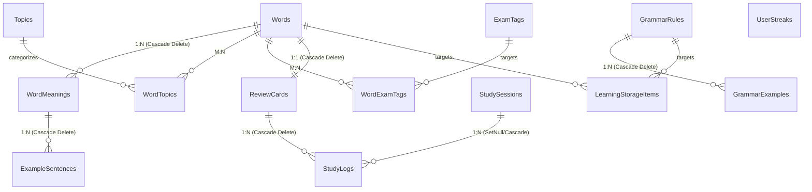

# 🗄️ Lexora Database Schema & Persistence Documentation

---

## 1. Engine Configuration & PRAGMA Settings

Lexora leverages an embedded **SQLite** database managed via **Entity Framework Core 10**.

- **Default File Path**: `%LocalAppData%\Lexora\data\lexora.db`
- **Companion Files**:
  - `%LocalAppData%\Lexora\data\lexora.db-wal` (Write-Ahead Log)
  - `%LocalAppData%\Lexora\data\lexora.db-shm` (Shared Memory Index)
- **Engine PRAGMAs**:
  ```sql
  PRAGMA journal_mode = WAL;          -- Enables concurrent reads during active writes
  PRAGMA foreign_keys = ON;           -- Enforces referential integrity and cascade deletes
  PRAGMA synchronous = NORMAL;        -- Optimal balance of durability and disk I/O performance
  PRAGMA busy_timeout = 5000;         -- 5-second busy timeout to mitigate concurrency locks
  ```

---

## 2. Entity-Relationship Diagram (ERD)



---

## 3. Detailed Table Specifications

### 3.1. `Words` (Root Vocabulary Entity)

| Column | Type | Nullable | Constraints | Description |
| :--- | :--- | :---: | :--- | :--- |
| `Id` | `TEXT` (Guid) | No | **PK** | Unique identifier (UUIDv4) |
| `Term` | `TEXT` (150) | No | Non-empty | Word or phrase (case-preserved for display) |
| `NormalizedTerm` | `TEXT` (150) | No | Indexed | Lowercased, trimmed for fast indexing & search |
| `PhoneticUk` | `TEXT` (100) | Yes | | British IPA phonetic notation |
| `PhoneticUs` | `TEXT` (100) | Yes | | American IPA phonetic notation |
| `AudioUkPath` | `TEXT` | Yes | | Local path to cached British MP3 audio |
| `AudioUsPath` | `TEXT` | Yes | | Local path to cached American MP3 audio |
| `Level` | `INTEGER` | No | Indexed | CEFR level enum (`0=None`, `1=A1`, `2=A2`, `3=B1`, `4=B2`, `5=C1`, `6=C2`) |
| `PrimaryPartOfSpeech` | `INTEGER` | No | Indexed | Primary POS enum (`Noun`, `Verb`, `Adjective`, etc.) |
| `Notes` | `TEXT` | Yes | | User memory cues, etymology, or personal notes |
| `CreatedAt` | `TEXT` (ISO8601)| No | | UTC timestamp of record creation |
| `UpdatedAt` | `TEXT` (ISO8601)| No | | UTC timestamp of last modification |

**Indexes**:
- `IX_Words_NormalizedTerm`: B-Tree index for prefix and equality searches.
- `IX_Words_Level`: Filtered index for CEFR level queries.
- `IX_Words_PrimaryPartOfSpeech`: Filtered index for part of speech categorization.

---

### 3.2. `WordMeanings` (Word Nuances & Definitions)

| Column | Type | Nullable | Constraints | Description |
| :--- | :--- | :---: | :--- | :--- |
| `Id` | `TEXT` (Guid) | No | **PK** | Unique identifier (UUIDv4) |
| `WordId` | `TEXT` (Guid) | No | **FK** -> `Words.Id` (Cascade) | Parent word foreign key |
| `PartOfSpeech` | `INTEGER` | No | | POS enum specific to this meaning |
| `DefinitionVi` | `TEXT` (500) | No | Non-empty | Primary Vietnamese translation/definition |
| `DefinitionEn` | `TEXT` (1000)| Yes | | English explanation/definition |
| `Explanation` | `TEXT` | Yes | | Nuance, context, and usage notes |
| `OrderIndex` | `INTEGER` | No | Default `0` | Order of presentation in UI card |

---

### 3.3. `ExampleSentences` (Bilingual Context Examples)

| Column | Type | Nullable | Constraints | Description |
| :--- | :--- | :---: | :--- | :--- |
| `Id` | `TEXT` (Guid) | No | **PK** | Unique identifier (UUIDv4) |
| `WordMeaningId` | `TEXT` (Guid) | No | **FK** -> `WordMeanings.Id` (Cascade) | Parent meaning foreign key |
| `SentenceEn` | `TEXT` (1000)| No | Non-empty | English sentence demonstrating usage |
| `SentenceVi` | `TEXT` (1000)| No | Non-empty | Vietnamese contextual translation |
| `AudioPath` | `TEXT` | Yes | | Optional local audio file for sentence playback |

---

### 3.4. `ReviewCards` (SRS / SM-2 State)

| Column | Type | Nullable | Constraints | Description |
| :--- | :--- | :---: | :--- | :--- |
| `Id` | `TEXT` (Guid) | No | **PK** | Unique identifier (UUIDv4) |
| `WordId` | `TEXT` (Guid) | No | **FK** -> `Words.Id` (Unique, Cascade) | 1-to-1 link with `Word` |
| `Status` | `INTEGER` | No | Indexed | Learning status (`0=New`, `1=Learning`, `2=Reviewing`, `3=Mastered`) |
| `EaseFactor` | `REAL` | No | Default `2.5`, $\ge 1.3$ | SuperMemo difficulty multiplier |
| `IntervalDays` | `INTEGER` | No | Default `0` | Days scheduled until next review |
| `Repetitions` | `INTEGER` | No | Default `0` | Consecutive successful reviews count |
| `Lapses` | `INTEGER` | No | Default `0` | Number of times forgotten (`Again` rating) |
| `NextReviewAt` | `TEXT` (ISO8601)| No | Indexed | UTC date/time when card becomes due |
| `LastReviewedAt`| `TEXT` (ISO8601)| Yes | | UTC date/time of most recent review |

**Indexes**:
- `IX_ReviewCards_NextReviewAt_Status`: Composite index for lightning-fast queue loading (`WHERE NextReviewAt <= @Now`).

---

### 3.5. `StudyLogs` & `StudySessions` (Historical Analytics)

- **`StudySessions`**:
  - `Id` (PK), `StartedAt`, `EndedAt`, `TotalCards`, `CardsReviewed`, `TestType`.
- **`StudyLogs`**:
  - `Id` (PK), `ReviewCardId` (FK), `StudySessionId` (FK Nullable).
  - `Rating` (1=Again, 2=Hard, 4=Good, 5=Easy).
  - `ResponseTimeMs` (Integer latency in milliseconds).
  - `IntervalDays` (Snapshot interval).
  - `EaseFactor` (Snapshot ease factor).
  - `ReviewedAt` (Timestamp).

---

### 3.6. `GrammarRules` & `GrammarExamples`

- **`GrammarRules`**:
  - `Id` (PK), `TitleEn`, `TitleVi`, `StructureFormula`, `ExplanationEn`, `ExplanationVi`, `CommonMistakes`, `Level` (CEFR), `ExamTag`, `OrderIndex`.
- **`GrammarExamples`**:
  - `Id` (PK), `GrammarRuleId` (FK Cascade), `SentenceEn`, `SentenceVi`, `Explanation`.

---

### 3.7. `UserStreaks`

- Single-row table tracking learner habit consistency:
  - `Id` (PK), `CurrentStreak` (Days), `LongestStreak` (Days), `LastActiveDate` (Date), `TotalReviewsCompleted`.

---

### 3.8. `LearningStorageItems` (Targeted Storage Vault)

Dedicated repository holding words or grammar rules marked for focused review or remedial study.

| Column | Type | Nullable | Constraints | Description |
| :--- | :--- | :---: | :--- | :--- |
| `Id` | `TEXT` (Guid) | No | **PK** | Unique identifier (UUIDv4) |
| `ItemType` | `INTEGER` | No | | `0 = Word`, `1 = GrammarRule` |
| `WordId` | `TEXT` (Guid) | Yes | **FK** -> `Words.Id` (SetNull) | Associated vocabulary word |
| `GrammarRuleId` | `TEXT` (Guid) | Yes | **FK** -> `GrammarRules.Id` (SetNull) | Associated grammar rule |
| `Status` | `INTEGER` | No | | `0=Learning`, `1=Reviewing`, `2=Mastered` |
| `ReasonAdded` | `INTEGER` | No | | `0=Manual`, `1=FailedQuiz`, `2=LowRetention`, `3=HighYield` |
| `Note` | `TEXT` | Yes | | Learner personal mnemonic or note |
| `IncorrectCount` | `INTEGER` | No | Default `0` | Number of incorrect recalls |
| `CorrectCount` | `INTEGER` | No | Default `0` | Number of correct recalls |
| `EaseFactor` | `REAL` | No | Default `2.5` | Storage item difficulty multiplier |
| `IntervalDays` | `INTEGER` | No | Default `1` | Interval days scheduled |
| `Repetitions` | `INTEGER` | No | Default `0` | Repetition count |
| `Lapses` | `INTEGER` | No | Default `0` | Forgetting lapses count |
| `RetentionProbability` | `REAL` | No | Default `50.0` | Modeled retrievability percentage |
| `NextReviewAt` | `TEXT` (ISO8601)| No | Indexed | Scheduled review timestamp |
| `LastReviewedAt`| `TEXT` (ISO8601)| Yes | | Last review timestamp |

---

## 4. Cascading & Deletion Invariants

1. **Deleting a `Word`**:
   - Automatically cascades and purges child `WordMeanings`, `ExampleSentences`, `ReviewCards`, and associated `StudyLogs`.
   - Cleans up `WordTopics` and `WordExamTags` junction records without deleting the shared `Topic` or `ExamTag` entities.
2. **Deleting a `GrammarRule`**:
   - Automatically cascades and deletes child `GrammarExamples`.
3. **Restoring Backups**:
   - Flushes connection pools via `SqliteConnection.ClearAllPools()` to release file locks before atomic swap.
