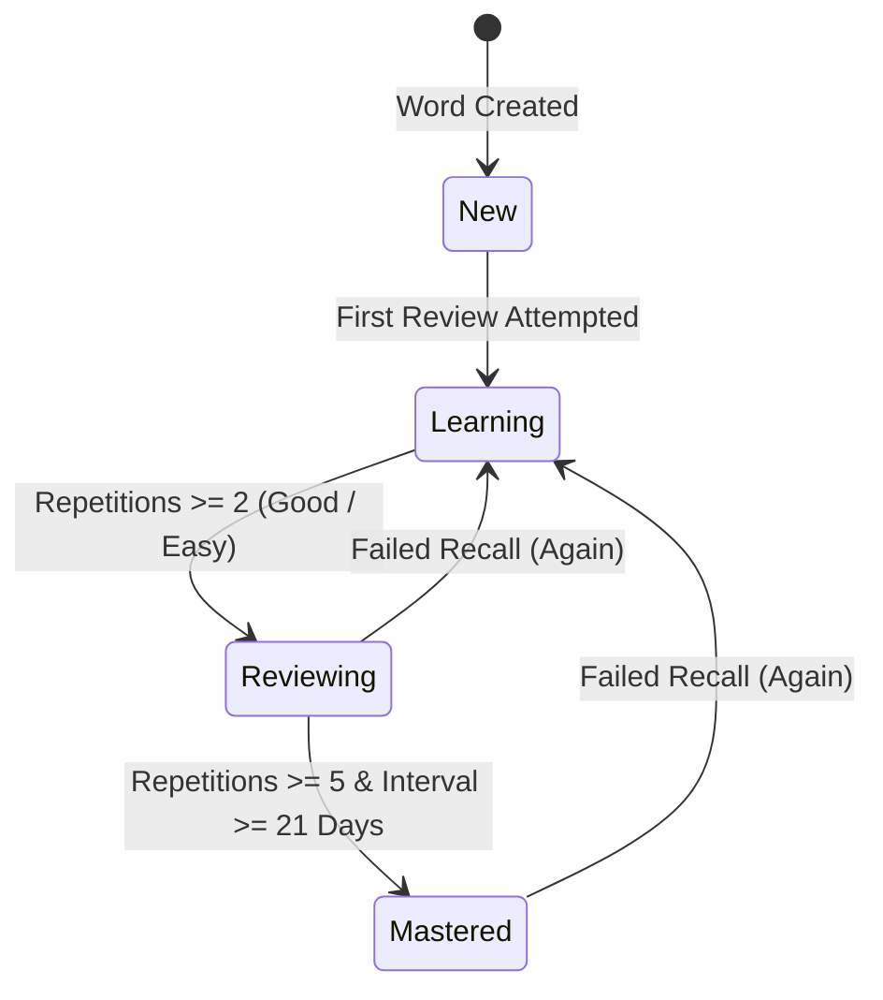

# Spaced Repetition Engine (SuperMemo SM-2) Documentation

---

## 1. Theoretical Foundation

Human memory follows the **Ebbinghaus Forgetting Curve**, where retained knowledge decays exponentially over time without deliberate reinforcement. The **Spaced Repetition System (SRS)** counteracts this decay by scheduling reviews at precisely calculated intervals just before the memory trace fades.

Lexora implements an optimized, mathematically verified version of the **SuperMemo SM-2** algorithm designed by Piotr Woźniak.

---

## 2. Mathematical Specification

### 2.1. Ease Factor ($EF$) Calculation
The Ease Factor reflects the intrinsic difficulty of a flashcard. A higher $EF$ causes intervals to grow more rapidly.

$$EF' = \max\left(1.3,\; EF + \left(0.1 - (5 - q) \cdot (0.08 + (5 - q) \cdot 0.02)\right)\right)$$

Where:
- $EF$: Current Ease Factor (initial default is $2.5$).
- $q$: Response quality rating ($q \in \{1, 2, 4, 5\}$).
- **Hard Floor Invariant**: $EF'$ is strictly clamped to $\ge 1.3$. This prevents difficult cards from entering "Ease Hell" (where intervals never increase).

### 2.2. Interval ($I$) Progression
The interval between reviews is calculated based on consecutive successful repetitions ($n$):

$$I(n) = \begin{cases} 
1 \text{ day}, & n = 1 \\ 
6 \text{ days}, & n = 2 \\ 
\text{Round}(I(n - 1) \cdot EF'), & n > 2 
\end{cases}$$

---

## 3. Rating Scale & Behavioral Matrix

Users evaluate their recall using 4 discrete buttons during a study session:

| Rating | Quality ($q$) | User Experience | Repetitions ($n$) | Interval Impact | Ease Factor ($EF$) |
| :---: | :---: | :--- | :---: | :--- | :--- |
| **Again** | `1` | Failed recall; complete memory lapse | Reset to `0` | Reset to `1` day | Reduced by $-0.20$ |
| **Hard** | `2` | Correct recall with severe hesitation/effort | Incremented ($n+1$) | $I(n) = \max(1, \text{Round}(I \cdot 1.2))$ | Reduced by $-0.15$ |
| **Good** | `4` | Successful, confident recall | Incremented ($n+1$) | $I(n) = \text{Round}(I \cdot EF')$ | Minor adjustment ($-0.00$) |
| **Easy** | `5` | Instant, effortless recall | Incremented ($n+1$) | $I(n) = \text{Round}(I \cdot EF' \cdot 1.3)$ | Increased by $+0.15$ |

---

## 4. Learning Status Lifecycle

Every word's review card progresses through well-defined lifecycle states:

- **`New`**: Word added to dictionary, awaiting first study session.
- **`Learning`**: Card actively undergoing early consolidation ($1 \le \text{Repetitions} < 2$).
- **`Reviewing`**: Stable retention; intervals expanding exponentially ($2 \le \text{Repetitions} < 5$).
- **`Mastered`**: High memory stability; card has survived $\ge 5$ consecutive successful reviews and interval exceeds $21$ days.
- **Lapse Handling**: Any card graded as **Again** automatically increments `Lapses`, resets `Repetitions` to `0`, schedules the next review for tomorrow, and returns the status to `Learning`.

---

## 5. Daily Streak Mechanics

- Completing at least one card review on a given calendar day advances the streak.
- If the user was active **yesterday** (in local user timezone), `CurrentStreak` increments by $+1$.
- If the user was active **today**, the streak is preserved without double-incrementing.
- If a full calendar day elapsed without activity, `CurrentStreak` resets to $1$.
- `LongestStreak` automatically updates whenever `CurrentStreak > LongestStreak`.
